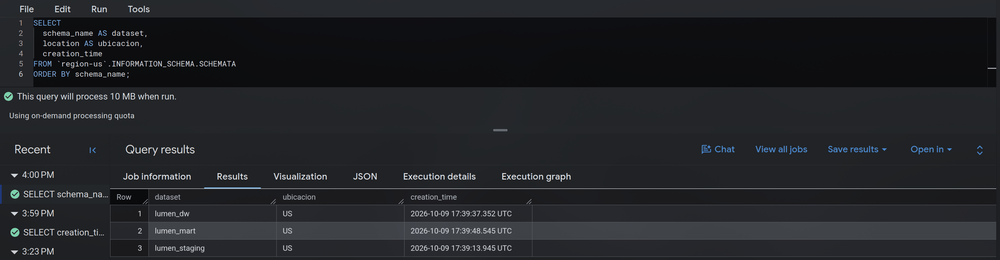
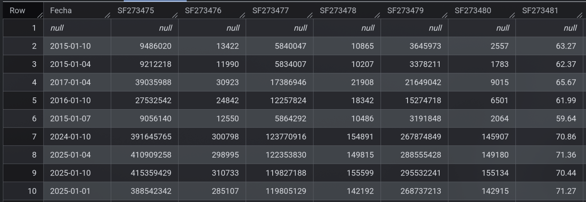
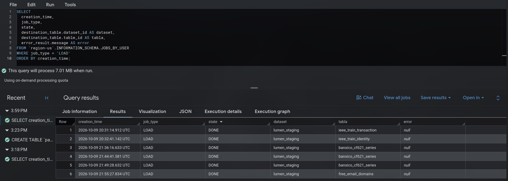

<style>
  /* El diagrama conserva fondo claro también en el tema oscuro, para que siga siendo legible */
  .diagrama-capas {
    background: #ffffff;
    border-radius: 8px;
    padding: 12px;
  }
</style>

Esta página describe la arquitectura del almacén de datos del proyecto y la evidencia de su
implementación en BigQuery. El almacén se organiza en tres capas, cada una en su propio dataset:
los datos crudos de las [fuentes del catálogo](fuentes.qmd), el
[esquema estrella](estrella.qmd) y las consultas que responden las
[preguntas de investigación de E0](../E0_comprension_negocio/preguntas.qmd).

La implementación es a escala reducida: staging contiene muestras, las tablas del esquema están
creadas y vacías, y las consultas son válidas pero todavía no devuelven filas. Poblar el almacén
corresponde a la preparación de los datos.

## Las tres capas

| Capa | Dataset | Papel | Contenido en esta entrega |
| :--- | :--- | :--- | :--- |
| **Staging** | `lumen_staging` | Recibir los datos tal como llegan de cada fuente, sin limpiar ni transformar | Cinco tablas con una muestra cruda de cada fuente |
| **DW** | `lumen_dw` | Guardar los datos ya integrados, en el esquema estrella | Dos tablas de hechos y cinco dimensiones, vacías |
| **DataMart** | `lumen_mart` | Responder las preguntas de E0 a partir del esquema estrella | Cuatro vistas, una o dos por pregunta |

: {tbl-colwidths="[12,18,38,32]"}

::: {.diagrama-capas}
```{mermaid}
flowchart LR
    F["<b>Fuentes</b><br/>A · IEEE-CIS<br/>B · Banco de México<br/>C · ULB<br/>D · Dominios de correo"]
    S["<b>lumen_staging</b><br/>datos crudos<br/>5 tablas"]
    W["<b>lumen_dw</b><br/>esquema estrella<br/>2 hechos y 5 dimensiones"]
    M["<b>lumen_mart</b><br/>consultas<br/>4 vistas"]
    F -->|"muestras"| S
    S -.->|"carga pendiente"| W
    W -->|"lectura"| M
```
:::

La flecha punteada marca lo que esta entrega no implementa: el paso de staging al DW requiere
transformar los datos, y esa transformación pertenece a la etapa siguiente. Las vistas del
DataMart leen del DW.

Los tres datasets están en el proyecto `pagos-lumen-dw` y en la misma ubicación, **US**. BigQuery
no permite consultas entre datasets de ubicaciones distintas, de modo que esa coincidencia es
condición para que las vistas del DataMart puedan leer del DW.



## Staging

La capa contiene cinco tablas, cargadas el 9 de octubre de 2026. La descripción de cada tabla en
BigQuery registra la fuente y la fecha de carga.

| Tabla | Fuente | Filas | Columnas | Contenido | Forma de carga |
| :--- | :--- | --: | --: | :--- | :--- |
| `ieee_train_transaction` | A | 56,059 | 394 | Muestra: los primeros 14 días del conjunto | Archivo CSV desde la consola; esquema detectado |
| `ieee_train_identity` | A | 18,964 | 41 | Registros de identidad de esas mismas transacciones | Archivo CSV desde la consola; esquema detectado |
| `banxico_cf621_series` | B | 46 | 25 | Los 45 trimestres del cuadro y una fila vacía | Archivo CSV desde la consola; esquema explícito y 19 líneas iniciales omitidas |
| `ulb_fraud_detection` | C | 284,807 | 31 | Copia completa de la tabla pública | Sentencia `CREATE TABLE ... AS SELECT` |
| `free_email_domains` | D | 14,326 | 1 | Una fila por línea del archivo JSON | Archivo cargado como texto, en una sola columna |

: {tbl-colwidths="[22,7,9,9,27,26]"}

**La muestra de IEEE-CIS.** La consola de BigQuery limita la carga a unos 100 MB por archivo, y
el de transacciones pesa 683 MB. La muestra se tomó por ventana de tiempo, y no por número de
filas, para que las dos tablas se correspondan: catorce días son dos semanas completas y pesan
64 MB. La tabla de identidad se filtró a las transacciones de esa ventana.

**Datos crudos.** Conforme al papel de la capa, las tablas conservan las condiciones de formato de
cada fuente, descritas en el [análisis de integración](fuentes.qmd#condiciones-de-formato-y-de-carga):
la fecha de Banco de México se guarda como texto, su archivo deja una fila vacía al final, y la
lista de dominios conserva los corchetes, las comillas y las comas del JSON. En esas dos tablas el
esquema se indicó de forma explícita: en la primera, porque la detección automática interpretaba
mal la fecha; en la segunda, para recibir cada línea como un solo texto.

### Evidencia por tabla

::: {.panel-tabset}
## ieee_train_transaction

::: {.panel-tabset}
## Detalles


## Filas


## Esquema


## Vista previa

:::

## ieee_train_identity

::: {.panel-tabset}
## Detalles


## Filas


## Esquema


## Vista previa

:::

## banxico_cf621_series

::: {.panel-tabset}
## Detalles


## Esquema


## Vista previa


## Fecha mal interpretada

:::

## ulb_fraud_detection

::: {.panel-tabset}
## Carga


## Detalles


## Esquema


## Vista previa

:::

## free_email_domains

::: {.panel-tabset}
## Detalles


## Esquema


## Vista previa

:::
:::

Las vistas previas de IEEE-CIS muestran pocas filas y pocas columnas, porque las reglas de la
competencia prohíben redistribuir sus datos.

### Evidencia del conjunto

::: {.panel-tabset}
## Tablas del dataset


## Trabajos de carga

:::

BigQuery registró seis trabajos de carga, todos terminados sin error. Tres corresponden a
`banxico_cf621_series`: los dos primeros se descartaron, uno por no omitir las líneas de
metadatos y otro por la fecha mal interpretada, y quedó el tercero. `ulb_fraud_detection` no
aparece en esa lista porque se creó con una sentencia SQL y no con un trabajo de carga.

## DW

La capa contiene las siete tablas del esquema estrella, creadas con SQL el 9 de octubre de 2026 y
todavía vacías. El grano, las medidas, las dimensiones, el diagrama, el DDL y la captura del
esquema de cada tabla se documentan en la página del [esquema estrella](estrella.qmd).

La consulta siguiente, hecha sobre el catálogo de BigQuery, resume el conjunto: cada tabla con sus
llaves declaradas y las preguntas de E0 que responde, según la descripción de la propia tabla.


## DataMart

La capa contiene cuatro vistas que leen únicamente de `lumen_dw`. Cada una responde una pregunta
de E0, y las cuatro usan operaciones OLAP: agrupaciones con `CUBE` o `ROLLUP` y funciones de
ventana. Su código corresponde al archivo `sql/consultas_mart.sql` del repositorio.

| Vista | Pregunta | Qué devuelve | Operación OLAP |
| :--- | :--- | :--- | :--- |
| `p1_tasa_por_segmento` | P1 | Tasa de fraude de cada combinación de producto, tipo de tarjeta, dispositivo y correo gratuito, comparada con la tasa global | `GROUP BY CUBE` |
| `p2_tramo_diario` | P2 y P1 | Por día, el fraude y el monto defraudado contenidos en el 0.75 % mejor ordenado, frente a lo esperado con un orden al azar | Funciones de ventana y `GROUP BY ROLLUP` |
| `p2_referencia_mexico` | P2 | Por año y tipo de tarjeta en México: autorizaciones, compra promedio y contracargos por número y por monto | `GROUP BY ROLLUP` |
| `p3_identidad` | P3 | Tasa de fraude con y sin registro de identidad, y por tipo de dispositivo | `GROUP BY ROLLUP` |

: {tbl-colwidths="[22,10,46,22]"}

Las cuatro consultas son válidas en BigQuery: se ejecutaron sin error y las vistas quedaron
creadas. Como el DW está vacío, todavía no devuelven filas, y esta entrega no reporta resultados.


### P1 · Combinaciones de atributos que separan el fraude

`p1_tasa_por_segmento` responde la primera parte de P1: qué combinación de atributos de la
transacción y del dispositivo separa mejor una operación fraudulenta de una legítima.

- `GROUP BY CUBE` calcula todas las combinaciones de los cuatro atributos: cada uno por separado,
  por pares, por tríos, los cuatro juntos y el total.
- `GROUPING` distingue un subtotal de un valor vacío real; las filas de subtotal se rotulan
  «Todos».
- `veces_tasa_global` divide la tasa de fraude del segmento entre la tasa de todo el periodo. Un
  valor de 3 indica un segmento con el triple de fraude que el promedio.

::: {.panel-tabset}
## Consulta
```sql
CREATE OR REPLACE VIEW `pagos-lumen-dw.lumen_mart.p1_tasa_por_segmento`
OPTIONS (
  description = 'Tasa de fraude por combinación de producto, tipo de tarjeta, dispositivo y correo gratuito, y cuántas veces supera a la tasa global. Todos marca un subtotal. Responde: P1.'
) AS
WITH tasa_global AS (
  SELECT SAFE_DIVIDE(SUM(es_fraude), COUNT(*)) AS tasa
  FROM `pagos-lumen-dw.lumen_dw.hechos_transaccion`
)
SELECT
  IF(GROUPING(p.producto_cd) = 1, 'Todos', p.producto_cd) AS producto,
  IF(GROUPING(t.tipo_tarjeta) = 1, 'Todos', t.tipo_tarjeta) AS tipo_tarjeta,
  IF(GROUPING(d.tipo_dispositivo) = 1, 'Todos', d.tipo_dispositivo) AS dispositivo,
  CASE
    WHEN GROUPING(c.es_gratuito) = 1 THEN 'Todos'
    WHEN c.es_gratuito IS NULL THEN 'Sin dato'
    WHEN c.es_gratuito THEN 'Gratuito'
    ELSE 'No gratuito'
  END AS correo,
  COUNT(*) AS transacciones,
  SUM(h.es_fraude) AS fraudes,
  SAFE_DIVIDE(SUM(h.es_fraude), COUNT(*)) AS tasa_fraude,
  SAFE_DIVIDE(SAFE_DIVIDE(SUM(h.es_fraude), COUNT(*)), ANY_VALUE(g.tasa)) AS veces_tasa_global
FROM `pagos-lumen-dw.lumen_dw.hechos_transaccion` AS h
JOIN `pagos-lumen-dw.lumen_dw.dim_producto` AS p ON p.producto_key = h.producto_key
JOIN `pagos-lumen-dw.lumen_dw.dim_tipo_tarjeta` AS t ON t.tipo_tarjeta_key = h.tipo_tarjeta_key
JOIN `pagos-lumen-dw.lumen_dw.dim_dispositivo` AS d ON d.dispositivo_key = h.dispositivo_key
JOIN `pagos-lumen-dw.lumen_dw.dim_dominio_correo` AS c ON c.dominio_correo_key = h.dominio_correo_key
CROSS JOIN tasa_global AS g
GROUP BY CUBE (p.producto_cd, t.tipo_tarjeta, d.tipo_dispositivo, c.es_gratuito);
```

## Validación en BigQuery

:::

### P2 · Monto defraudado en el tramo revisable

`p2_tramo_diario` mide qué fracción del monto defraudado queda dentro del 0.75 % de las
transacciones de cada día, que es la capacidad de revisión fijada en E0.

- Las funciones de ventana numeran las transacciones de cada día según un orden (`ROW_NUMBER`) y
  cuentan cuántas hubo ese día (`COUNT(*) OVER`); `PARTITION BY` reinicia el cálculo cada día.
- Con eso se marca el 0.75 % superior de cada día y se resume cuánto fraude y cuánto monto
  contiene. `ROLLUP` agrega una fila con el total del periodo.
- `fraccion_esperada_al_azar` es la proporción que ocupa el tramo. Es lo que contendría con un
  orden aleatorio, y sirve de línea base.

El orden que usa la vista, de mayor a menor importe, es una regla simple que ocupa el lugar del
modelo, que todavía no existe. Cuando exista, bastará sustituir el `ORDER BY` de la ventana por su
puntaje. Por eso la vista sirve también a P1, como línea base de reglas simples. El corte diario
es una forma de simular la evaluación: en operación, el puntaje se asigna a cada transacción al
llegar.

::: {.panel-tabset}
## Consulta
```sql
CREATE OR REPLACE VIEW `pagos-lumen-dw.lumen_mart.p2_tramo_diario`
OPTIONS (
  description = 'Por día: fraude y monto defraudado contenidos en el 0.75 % de transacciones mejor ordenadas con una regla simple (mayor importe primero), frente a lo esperado con un orden al azar. La fila sin fecha es el total. Responde: P1, P2.'
) AS
WITH ordenadas AS (
  SELECT
    fecha_key,
    es_fraude,
    monto_fraude_usd,
    ROW_NUMBER() OVER (PARTITION BY fecha_key ORDER BY monto_usd DESC, transaccion_id) AS posicion,
    COUNT(*) OVER (PARTITION BY fecha_key) AS transacciones_dia
  FROM `pagos-lumen-dw.lumen_dw.hechos_transaccion`
),
marcadas AS (
  SELECT
    fecha_key,
    es_fraude,
    monto_fraude_usd,
    posicion <= CEIL(0.0075 * transacciones_dia) AS en_tramo
  FROM ordenadas
)
SELECT
  f.fecha,
  COUNT(*) AS transacciones,
  COUNTIF(m.en_tramo) AS transacciones_en_tramo,
  SUM(m.es_fraude) AS fraudes,
  SUM(IF(m.en_tramo, m.es_fraude, 0)) AS fraudes_en_tramo,
  SUM(m.monto_fraude_usd) AS monto_fraude_usd,
  SUM(IF(m.en_tramo, m.monto_fraude_usd, 0)) AS monto_fraude_en_tramo_usd,
  SAFE_DIVIDE(SUM(IF(m.en_tramo, m.monto_fraude_usd, 0)), SUM(m.monto_fraude_usd)) AS fraccion_monto_en_tramo,
  SAFE_DIVIDE(COUNTIF(m.en_tramo), COUNT(*)) AS fraccion_esperada_al_azar
FROM marcadas AS m
JOIN `pagos-lumen-dw.lumen_dw.dim_fecha` AS f ON f.fecha_key = m.fecha_key
GROUP BY ROLLUP (f.fecha);
```

## Validación en BigQuery

:::

### P2 · Referencia de México

`p2_referencia_mexico` da el contexto nacional de P2: cuánto representan los contracargos por
número y por monto en el comercio electrónico mexicano. Es la consulta que usa la segunda tabla de
hechos y las dos dimensiones compartidas.

- `ROLLUP` produce tres niveles: año y tipo de tarjeta, el subtotal de cada año y el total.
- Los porcentajes de contracargos no son aditivos. Para agregarlos, cada uno se multiplica por su
  volumen, se suma y se divide entre el volumen total: un promedio ponderado.
- `compra_promedio_mxn` divide el monto autorizado entre el número de autorizaciones.

::: {.panel-tabset}
## Consulta
```sql
CREATE OR REPLACE VIEW `pagos-lumen-dw.lumen_mart.p2_referencia_mexico`
OPTIONS (
  description = 'Por año y tipo de tarjeta: autorizaciones, monto, compra promedio y porcentaje de contracargos por número y por monto en comercio electrónico en México (Banxico, CF621). Todos marca un subtotal. Responde: P2.'
) AS
SELECT
  IF(GROUPING(f.anio) = 1, 'Todos', CAST(f.anio AS STRING)) AS anio,
  IF(GROUPING(t.tipo_tarjeta) = 1, 'Todos', t.tipo_tarjeta) AS tipo_tarjeta,
  SUM(h.num_autorizaciones) AS num_autorizaciones,
  SUM(h.monto_autorizado_mdp) AS monto_autorizado_mdp,
  SAFE_DIVIDE(SUM(h.monto_autorizado_mdp) * 1000000, SUM(h.num_autorizaciones)) AS compra_promedio_mxn,
  SAFE_DIVIDE(SUM(h.pct_contracargo_num * h.num_autorizaciones), SUM(h.num_autorizaciones)) AS pct_contracargo_num,
  SAFE_DIVIDE(SUM(h.pct_contracargo_monto * h.monto_autorizado_mdp), SUM(h.monto_autorizado_mdp)) AS pct_contracargo_monto
FROM `pagos-lumen-dw.lumen_dw.hechos_pagos_trimestre` AS h
JOIN `pagos-lumen-dw.lumen_dw.dim_fecha` AS f ON f.fecha_key = h.fecha_key
JOIN `pagos-lumen-dw.lumen_dw.dim_tipo_tarjeta` AS t ON t.tipo_tarjeta_key = h.tipo_tarjeta_key
GROUP BY ROLLUP (f.anio, t.tipo_tarjeta);
```

## Validación en BigQuery

:::

### P3 · Ausencia de identidad como señal de riesgo

`p3_identidad` compara la tasa de fraude de las transacciones con y sin registro de identidad del
dispositivo. Si las dos tasas difieren, la ausencia es una señal y no conviene imputarla; si son
parecidas, es solo un hueco.

- `ROLLUP` produce el detalle por tipo de dispositivo, el subtotal de cada grupo y el total.
- La tasa se calcula por número y por monto, porque el criterio de éxito de E0 está expresado en
  dinero y no en número de operaciones.

::: {.panel-tabset}
## Consulta
```sql
CREATE OR REPLACE VIEW `pagos-lumen-dw.lumen_mart.p3_identidad`
OPTIONS (
  description = 'Tasa de fraude, por número y por monto, de las transacciones con y sin registro de identidad, y por tipo de dispositivo. Todos y Todas marcan un subtotal. Responde: P3.'
) AS
SELECT
  IF(GROUPING(d.tiene_identidad) = 1, 'Todas', IF(d.tiene_identidad, 'Con identidad', 'Sin identidad')) AS registro_identidad,
  IF(GROUPING(d.tipo_dispositivo) = 1, 'Todos', d.tipo_dispositivo) AS dispositivo,
  COUNT(*) AS transacciones,
  SUM(h.es_fraude) AS fraudes,
  SAFE_DIVIDE(SUM(h.es_fraude), COUNT(*)) AS tasa_fraude,
  SUM(h.monto_fraude_usd) AS monto_fraude_usd,
  SAFE_DIVIDE(SUM(h.monto_fraude_usd), SUM(h.monto_usd)) AS tasa_fraude_monto
FROM `pagos-lumen-dw.lumen_dw.hechos_transaccion` AS h
JOIN `pagos-lumen-dw.lumen_dw.dim_dispositivo` AS d ON d.dispositivo_key = h.dispositivo_key
GROUP BY ROLLUP (d.tiene_identidad, d.tipo_dispositivo);
```

## Validación en BigQuery

:::

### P4 · Sin consulta

P4 pregunta cuántas de las transacciones rechazadas automáticamente eran en realidad legítimas.
No puede responderse con este diseño, por dos razones:

- Ninguna fuente del catálogo registra operaciones rechazadas ni su desenlace. IEEE-CIS trae la
  etiqueta de fraude de cada transacción, pero ninguna columna que indique si fue rechazada.
- En consecuencia, el esquema no tiene un hecho que las represente.

Lo más cercano son los porcentajes de aceptación de `hechos_pagos_trimestre`, que indican qué
proporción de los intentos de pago se acepta en México. Miden el tamaño del rechazo, no cuántos de
los rechazados eran legítimos. La pregunta queda sin cubrir, como E0 ya había declarado.
