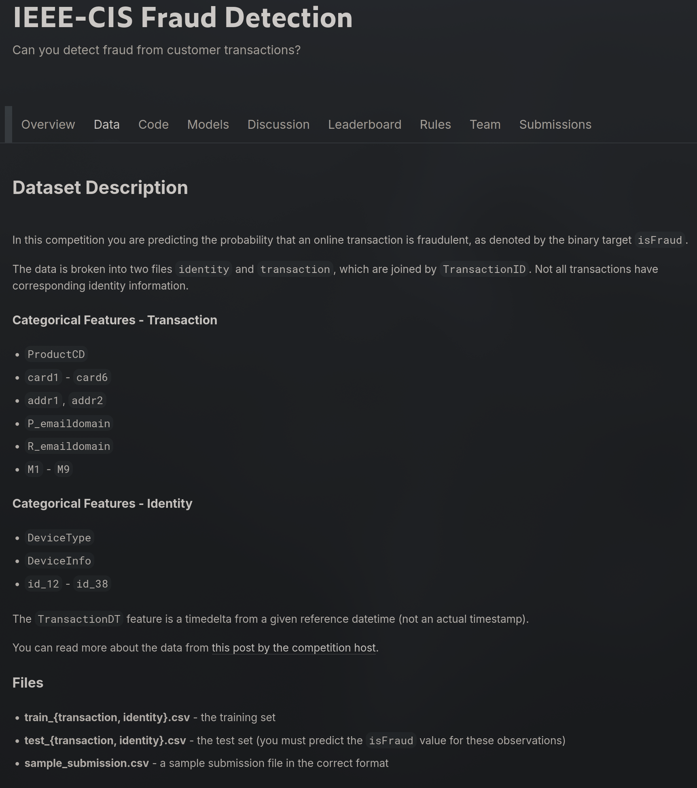
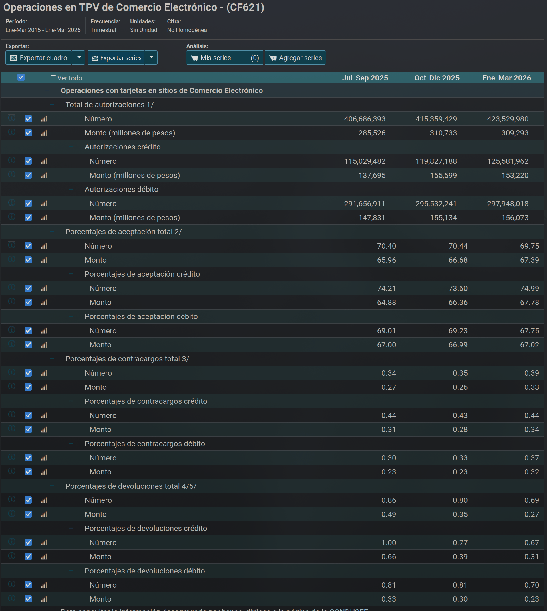
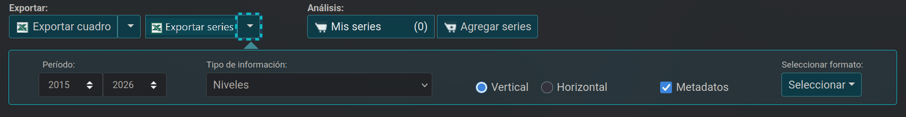
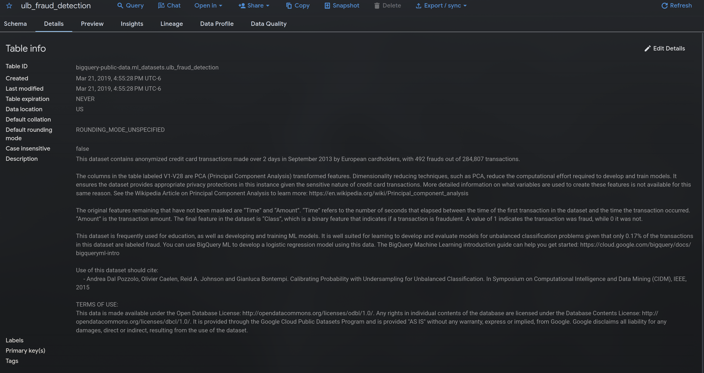
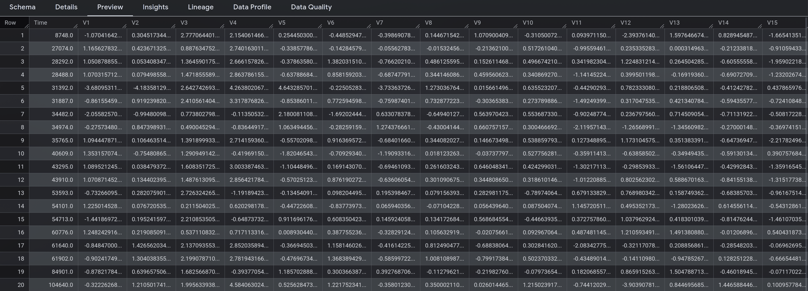

Esta página documenta las fuentes de datos del proyecto: cómo se buscaron, cuáles se evaluaron,
cuáles forman el catálogo y cómo se integran en un solo almacén. De ellas dependen el grano de la
tabla de hechos y las dimensiones del esquema que se describen en las páginas siguientes.

El catálogo reúne **cuatro fuentes de cuatro tipos distintos**, seleccionadas entre diez
candidatas. A lo largo de esta entrega, las cuatro
[preguntas de investigación de E0](../E0_comprension_negocio/preguntas.qmd) se identifican como
**P1 a P4**, en su orden original.

## Proceso de búsqueda

La búsqueda se realizó el **9 de octubre de 2026** y combinó tres vías, de modo que ninguna fuente
dependiera de una sola herramienta.

| Vía | Papel en la búsqueda |
| :--- | :--- |
| **Claude** (Anthropic), con búsqueda web | Quince consultas dirigidas, de las que salieron las candidatas iniciales |
| **Gemini** (Google), en modo Deep Research | Búsqueda independiente con el mismo encargo, sin conocer las candidatas ya localizadas, para contrastar los resultados |
| **Revisión directa en portales** | Apertura de cada candidata en su portal de origen |

Las dos herramientas coincidieron en los dos conjuntos de transacciones etiquetadas y en Banco de
México como referencia oficial. Su salida se trató como una lista de propuestas, no como
evidencia: **una fuente solo entró al catálogo después de que el equipo la abriera** y comprobara
que la dirección existe, que el grano y la cobertura son los declarados y que la licencia permite
el uso. Los prompts y los errores detectados en las salidas se documentan en la página de
[uso de herramientas de IA](uso_ia.qmd) de esta entrega.

::: {.callout-note collapse="true" title="Consultas de búsqueda (texto exacto)"}
1. `bigquery-public-data ml_datasets ulb_fraud_detection table credit card fraud`
2. `IEEE-CIS Fraud Detection Kaggle competition rules data use "non-commercial" academic research Vesta dataset license`
3. `Bank Account Fraud dataset NeurIPS 2022 Feedzai license CC BY-NC-ND tabular fraud dataset`
4. `Banxico SIE comercio electrónico tarjetas contracargos número importe serie CF621 tasa de aceptación`
5. `CNBV portafolio de información reclamaciones fraude comercio electrónico tarjeta base de datos descarga R27 "reclamaciones" datos abiertos`
6. `CONDUSEF Buró de Entidades Financieras datos abiertos reclamaciones fraude base de datos descargar CSV datos.gob.mx`
7. `disposable-email-domains GitHub list license CC0 disposable_email_blocklist.conf`
8. `Google Play supported devices CSV download "supported_devices.csv" retail branding marketing name device model`
9. `Federal Reserve Payments Study card-not-present fraud value number data tables download xlsx remote card fraud`
10. `CNBV información estadística reclamaciones "comercio por internet" banca múltiple R27 consulta descarga portafolio de información tabla dinámica`
11. `INEGI ENVIPE fraude bancario clonación de tarjeta microdatos víctimas monto pérdida datos abiertos`
12. `ECB data portal card fraud statistics card-not-present fraud value volume by country payments statistics dataset download`
13. `Kaggle PaySim synthetic financial datasets for fraud detection ealaxi paysim1 rows license CC BY-SA`
14. `Banco de México aviso legal términos de uso información SIE "citar la fuente" reproducción de la información estadística`
15. `"Credit Card Fraud Detection" mlg-ulb creditcardfraud Kaggle license "Database Contents License" DbCL Worldline ULB citation`
:::

### Portales revisados

La tabla registra los portales consultados, incluidos los que no aportaron datos utilizables.

| Portal | Búsqueda | Hallazgo |
| :--- | :--- | :--- |
| [Kaggle](https://www.kaggle.com/competitions/ieee-fraud-detection) | Conjuntos de transacciones con etiqueta de fraude | Fuente A; una candidata descartada |
| [Banco de México, SIE](https://www.banxico.org.mx/SieInternet/consultarDirectorioInternetAction.do?sector=21&accion=consultarCuadro&idCuadro=CF621&locale=es) | Cuadros de sistemas de pago | Fuente B |
| Datos públicos de BigQuery (`bigquery-public-data`) | Tablas de fraude con tarjeta | Fuente C |
| [GitHub](https://github.com/) | Catálogos para enriquecer atributos: dominios de correo y rangos de tarjeta | Fuente D; dos candidatas descartadas |
| [CONDUSEF](https://www.condusef.gob.mx/?p=estadisticas) | Estadísticas de comercio electrónico | Reproduce las cifras de Banco de México |
| [datos.gob.mx](https://www.datos.gob.mx/dataset/?q=fraude) | Término «fraude» y bases publicadas por CONDUSEF | La búsqueda no devuelve bases de datos. CONDUSEF publica 29 bases; las revisadas tratan de cláusulas abusivas, unidades especializadas y calificaciones por producto, y no se localizó ninguna de transacciones ni de fraude |
| [CNBV, Portafolio de Información](https://portafolioinfo.cnbv.gob.mx/Temas/Reclamaciones/Paginas/default.aspx) | Reclamaciones por canal y monto | La página abre, pero el visor de reportes falla con «Error de elemento web» |
| [Ayuda de Google Play](https://support.google.com/googleplay/android-developer/answer/9859371?hl=en) | Catálogo de modelos de dispositivos | Solo se descarga desde una cuenta de desarrollador |

: {tbl-colwidths="[26,30,44]"}

## Candidatas evaluadas y criterios de selección

Se evaluaron diez candidatas. Para entrar al catálogo, una fuente debía cumplir cinco criterios,
derivados de las preguntas de E0 y de las condiciones de esta entrega:

1. Relación directa con alguna pregunta de E0.
2. Datos reales, no sintéticos.
3. Acceso comprobable por el equipo y licencia que permita el uso académico.
4. Posibilidad de integración: una llave o un atributo en común con otra fuente.
5. Carga factible en staging: menos de 100 MB por archivo, o una tabla que ya esté en BigQuery.

| # | Candidata | Tipo | Decisión | Motivo |
| :-- | :--- | :--- | :--- | :--- |
| 1 | IEEE-CIS Fraud Detection | Archivos CSV de una competencia de Kaggle | **Catálogo (A)** | Transacciones reales de comercio electrónico con etiqueta de fraude. Es la fuente del hecho principal |
| 2 | Banco de México, cuadro CF621 | Base institucional con exportación | **Catálogo (B)** | Referencia oficial de México, con contracargos por número y por monto |
| 3 | ULB Credit Card Fraud | Tabla pública de BigQuery | **Catálogo (C)** | Segunda población real con etiqueta de fraude, para contraste |
| 4 | `free-email-domains` | Archivo en un repositorio abierto | **Catálogo (D)** | Se une por llave con IEEE-CIS: 52 de sus 60 dominios de correo coinciden |
| 5 | [`disposable-email-domains`](https://github.com/disposable-email-domains/disposable-email-domains) | Archivo en un repositorio abierto | Descartada | Lista de dominios de correo desechables. Ninguno de los 60 dominios de IEEE-CIS aparece en ella |
| 6 | [`binlist-data`](https://github.com/Techbuddie-Solutions/binlist-data) | Archivo en un repositorio abierto | Descartada | Se une por los seis primeros dígitos de la tarjeta, e IEEE-CIS no los trae: `card1` es un valor enmascarado |
| 7 | [Estadísticas de comercio electrónico de CONDUSEF](https://www.condusef.gob.mx/?p=estadisticas) | Página institucional | Descartada | Cita como fuente al SIE de Banco de México. Se prefiere la fuente primaria |
| 8 | [PaySim](https://www.kaggle.com/datasets/ealaxi/paysim1) | Dataset de Kaggle | Descartada | Su descripción lo declara sintético, generado con un simulador |
| 9 | [Catálogo de dispositivos de Google Play](https://support.google.com/googleplay/android-developer/answer/9859371?hl=en) | Exportación de una consola | Descartada | Se habría unido con el modelo del dispositivo, pero exige una cuenta de desarrollador |
| 10 | [CNBV, reclamaciones](https://portafolioinfo.cnbv.gob.mx/Temas/Reclamaciones/Paginas/default.aspx) | Base institucional | Descartada | Inaccesible: el visor de reportes no carga |

: {tbl-colwidths="[4,24,20,13,39]"}

Ninguna candidata permite responder P4: no se localizó una fuente pública con operaciones
rechazadas y su desenlace, condición que E0 ya había declarado.

## Catálogo de fuentes

Cada ficha registra los ocho campos del catálogo y dos evidencias de verificación: la página de
origen y una vista previa de los datos. Las cuatro fuentes se verificaron el 9 de octubre de 2026.

### A · IEEE-CIS Fraud Detection

| Campo | Contenido |
| :--- | :--- |
| **Nombre y dueño** | IEEE-CIS Fraud Detection. Competencia de Kaggle patrocinada por la IEEE Computational Intelligence Society; los datos son de Vesta Corporation |
| **URL y acceso** | <https://www.kaggle.com/competitions/ieee-fraud-detection/data>. Descarga, o uso en un notebook de Kaggle, tras aceptar las reglas de la competencia |
| **Formato y tamaño** | CSV. `train_transaction.csv`: 590,540 filas, 394 columnas, 683 MB. `train_identity.csv`: 144,233 filas, 41 columnas, 27 MB |
| **Grano** | Transacciones: una fila por transacción. Identidad: una fila por transacción que tiene registro de identidad |
| **Cobertura** | 182 días consecutivos. La fuente no publica las fechas reales ni el territorio. No se actualiza: la competencia corrió del 15 de julio al 3 de octubre de 2019 |
| **Licencia y restricciones** | Reglas de la competencia, sección 7. Permiten el uso no comercial, que incluye «academic research and education», y prohíben redistribuir los datos a quien no participa. Por eso el repositorio no contiene ningún archivo de datos y las vistas previas muestran pocas filas. La fuente entrega las variables enmascaradas |
| **Llaves de integración** | `TransactionID` entre sus dos tablas. `P_emaildomain` con la fuente D. `card6` (crédito o débito) con la fuente B. `TransactionDT` es un tiempo relativo en segundos, no una fecha |
| **Preguntas de E0** | P1, P2, P3 |

El conjunto contiene 20,663 transacciones fraudulentas, el 3.5 % del total. `TransactionID` es
único en las dos tablas, y solo el 24.4 % de las transacciones tiene registro de identidad. Las
cifras se obtuvieron sobre el conjunto completo, en un notebook de Kaggle.

::: {.panel-tabset}
## Página de origen

## Vista previa

:::

### B · Banco de México, cuadro CF621

| Campo | Contenido |
| :--- | :--- |
| **Nombre y dueño** | «Operaciones en TPV de Comercio Electrónico», cuadro CF621 del Sistema de Información Económica (SIE). Banco de México |
| **URL y acceso** | [Cuadro CF621 en el SIE](https://www.banxico.org.mx/SieInternet/consultarDirectorioInternetAction.do?sector=21&accion=consultarCuadro&idCuadro=CF621&locale=es). Descarga sin registro, con «Exportar cuadro» o «Exportar series» |
| **Formato y tamaño** | Excel o CSV. 45 trimestres por 24 series; unos pocos kilobytes |
| **Grano** | Un valor por trimestre y serie. Cada serie combina un concepto (autorizaciones, aceptación, contracargos, devoluciones), un tipo de tarjeta (total, crédito, débito) y una unidad (número o monto) |
| **Cobertura** | Enero-marzo de 2015 a enero-marzo de 2026. México. Trimestral |
| **Licencia y restricciones** | [«Salvedad al uso de esta página»](https://www.banxico.org.mx/footer-es/salvedad-politicas-uso-banco-.html): se autoriza reproducir o utilizar la información citando la fuente y la dirección del sitio. Son agregados nacionales, sin datos personales |
| **Llaves de integración** | Tipo de tarjeta (crédito o débito), con `card6` de la fuente A. El periodo no se une con la fuente A, que no tiene fechas de calendario |
| **Preguntas de E0** | P2, como referencia de México |

El cuadro define el contracargo como la operación que el tarjetahabiente reclama a su emisor por
no reconocer el cargo o el monto de la compra, medida sobre los pagos autorizados. En enero-marzo
de 2026, los contracargos representaron el 0.39 % del número de pagos autorizados y el 0.33 % de
su monto.

::: {.panel-tabset}
## Página de origen y vista previa

## Exportación

:::

### C · ULB Credit Card Fraud

| Campo | Contenido |
| :--- | :--- |
| **Nombre y dueño** | Credit Card Fraud Detection. Conjunto reunido en una colaboración de investigación entre Worldline y el Machine Learning Group de la Université Libre de Bruxelles (ULB), según el [codelab de Google](https://codelabs.developers.google.com/codelabs/frauddetection-using-console?hl=es) que usa esta tabla. Google lo publica en BigQuery dentro de su programa de datos públicos |
| **URL y acceso** | Tabla `bigquery-public-data.ml_datasets.ulb_fraud_detection`, consultable desde cualquier proyecto de BigQuery |
| **Formato y tamaño** | Tabla de BigQuery. 284,807 filas, 31 columnas, 67 MB |
| **Grano** | Una fila por transacción con tarjeta de crédito |
| **Cobertura** | Dos días de septiembre de 2013; tarjetahabientes europeos. No se actualiza: la tabla no cambia desde marzo de 2019 |
| **Licencia y restricciones** | Open Database License 1.0 para la base y Database Contents License 1.0 para los contenidos, según los términos de la propia tabla. Pide citar a Dal Pozzolo, Caelen, Johnson y Bontempi (CIDM, IEEE, 2015). Variables transformadas con PCA, sin datos personales |
| **Llaves de integración** | Ninguna. Comparte con la fuente A solo la forma: importe, etiqueta de fraude y tiempo relativo en segundos |
| **Preguntas de E0** | P2, como población de contraste |

Su proporción de fraude es de 0.17 % (492 de 284,807), muy por debajo del 3.5 % de la fuente A.
Contar con dos poblaciones tan distintas permite razonar cómo cambia un resultado con la
frecuencia del fraude. Su límite es que reúne compras con tarjeta en general, no solo de comercio
electrónico.

::: {.panel-tabset}
## Página de origen

## Vista previa

:::

### D · Lista de dominios de correo gratuitos

| Campo | Contenido |
| :--- | :--- |
| **Nombre y dueño** | `free-email-domains`, repositorio público mantenido por Kikobeats en GitHub |
| **URL y acceso** | <https://github.com/Kikobeats/free-email-domains>. Descarga directa del archivo `domains.json` |
| **Formato y tamaño** | JSON: un arreglo con 14,324 dominios, en 14,326 líneas. 267 KB |
| **Grano** | Un elemento por dominio de correo |
| **Cobertura** | Global, sin periodo. Se actualiza con frecuencia: tiene 233 versiones publicadas, y la utilizada (1.13.0) se publicó el mismo día de la consulta |
| **Licencia y restricciones** | MIT. Sin datos personales |
| **Llaves de integración** | El dominio, con `P_emaildomain` de la fuente A |
| **Preguntas de E0** | P1: agrega a cada dominio el atributo de proveedor gratuito |

El README del repositorio la describe como una lista de dominios de correo gratuitos y
desechables.

::: {.panel-tabset}
## Página de origen

## Vista previa

:::

## Análisis de integración

Las cuatro fuentes no comparten una llave única ni un mismo grano. Esta sección establece por qué
campos pueden unirse, en qué difieren y qué condiciones deberá resolver la preparación de los
datos. Conforme al alcance de esta entrega, los problemas se identifican y se documentan, sin
resolverse todavía.

### Campos de unión

| Fuentes | Campo de unión | Resultado | Problemas anticipados |
| :--- | :--- | :--- | :--- |
| Las dos tablas de A | `TransactionID` | Unión sin pérdidas: las 144,233 filas de identidad tienen transacción | El 75.6 % de las transacciones no tiene identidad. La unión debe conservarlas: esa ausencia es el objeto de P3 |
| A y D | Dominio de correo | Coinciden 52 de los 60 dominios distintos de A, contando comprador y receptor | Ocho no coinciden, entre ellos `gmail`, escrito sin terminación, y `anonymous.com`, un valor enmascarado. El 16.0 % de las transacciones no trae dominio |
| A y B | Tipo de tarjeta | Es un atributo que puede conformarse; no hay llave fila a fila | `card6` trae valores que Banco de México no reporta: `debit or credit` (30 filas), `charge card` (15) y vacíos (1,571) |
| A y C | Ninguno | No se unen | C no tiene atributos con significado: sus variables son componentes principales |

: {tbl-colwidths="[16,18,30,36]"}

Los ocho dominios sin correspondencia son `anonymous.com`, `centurylink.net`, `gmail`,
`prodigy.net.mx`, `sc.rr.com`, `scranton.edu`, `servicios-ta.com` y `suddenlink.net`.

### Diferencias de granularidad

| Fuente | Una fila es | Periodo | Unidad del importe |
| :--- | :--- | :--- | :--- |
| A | Una transacción | 182 días, sin fecha de calendario | Dólares |
| B | Un trimestre y una serie | 2015 a 2026 | Millones de pesos |
| C | Una transacción | Dos días de 2013 | No declarada en la tabla |
| D | Un dominio | Sin periodo | No aplica |

: {tbl-colwidths="[10,30,35,25]"}

Las fuentes A y B no pueden compartir una tabla: una registra operaciones individuales y la otra,
totales trimestrales de un país. Reducir A al grano de B anularía el objetivo de E0, que es
ordenar transacciones una por una. Por eso el diseño conserva los dos granos en tablas de hechos
separadas, que comparten el tipo de tarjeta y la fecha.

### Condiciones de formato y de carga

Además de las diferencias de llave y de grano, cada fuente tiene condiciones de formato que la
preparación de los datos deberá resolver. Las que siguen se comprobaron al cargar las muestras en
staging.

| # | Fuente | Condición observada | Tratamiento previsto |
| :-- | :--- | :--- | :--- |
| 1 | A | Las primeras filas de sus dos archivos no se corresponden: al tomar las primeras 1,000 de cada uno, solo 296 transacciones tenían su fila de identidad | Muestrear por ventana de tiempo, no por número de filas |
| 2 | A | El archivo de transacciones (683 MB) supera el límite de carga de la consola de BigQuery | Cargar el conjunto completo por otra vía |
| 3 | A | La fuente no publica la fecha de referencia de `TransactionDT` | Trabajar con un supuesto declarado y conservar el valor original |
| 4 | B | La fecha se publica como día/mes/año. La detección automática de BigQuery la interpreta como mes/día/año sin marcar error: el 1 de octubre de 2015 se lee como 10 de enero | Convertir la fecha indicando el formato |
| 5 | B | El archivo incluye 18 líneas de metadatos antes de los datos, y las columnas se nombran con identificadores de serie (`SF273475` a `SF273498`) | Renombrar las columnas con el título de cada serie |
| 6 | B | Formato ancho: una columna por serie. El almacén requiere una fila por trimestre y tipo de tarjeta | Reorganizar las columnas en filas |
| 7 | B | Los porcentajes se publican ya calculados, y no pueden sumarse ni promediarse entre trimestres | Agregarlos ponderando por el número o el monto de autorizaciones |
| 8 | D | Es un arreglo JSON, que la consola no carga como tabla | Quitar corchetes, comillas y comas, y dejar un dominio por fila |
| 9 | D | La lista cambia con frecuencia: un dominio puede entrar o salir | Conservar la versión de la lista con la que se obtuvo cada resultado |

: {tbl-colwidths="[5,9,46,40]"}

### Incorporación al almacén

El análisis anterior determina el papel de cada fuente en el diseño:

- **A** aporta la tabla de hechos principal, con una fila por transacción.
- **B** aporta una segunda tabla de hechos, con una fila por trimestre y tipo de tarjeta.
- **D** se integra como un atributo de la dimensión de dominio de correo.
- **C** permanece en staging como población de contraste. No trae producto, dispositivo, correo ni
  fecha, de modo que en el esquema casi todas sus dimensiones quedarían como «no aplica».
