<style>
  /* Tablas con texto largo en la primera columna (anula la regla global) */
  body main table td:first-child { white-space: normal; }
</style>

Esta página caracteriza el conjunto de datos del proyecto antes de limpiarlo y documenta los hallazgos
para la preparación. Retoma las
[preguntas de investigación de E0](../E0_comprension_negocio/preguntas.qmd) (P1 a P4) y el
[esquema de E1](../E1_arquitectura_dw/estrella.qmd).

::: {.callout-tip appearance="minimal"}
**Resumen:** el fraude de IEEE-CIS se concentra en pocos productos, tarjetas e importes,
la ausencia de identidad es estructural y va con menos fraude, el primer mes es un régimen
distinto, y ordenar por importe no da más aciertos que el azar aunque cubre diez veces más
dinero.
:::

## Datos iniciales

El análisis se hace sobre `lumen_prep.analitico_crudo`, que crea el paso `ingesta` del
[pipeline](https://github.com/alangm-98/Proyecto_Mineria_Datos/tree/main/pipeline): las dos
tablas de la fuente A unidas por `TransactionID` al grano de E1, sin limpiar. Se
agregaron cuatro columnas para leer el tiempo y la unión.

| Característica | Valor |
| :--- | :--- |
| Grano | Una fila por transacción con tarjeta en e-commerce (E1) |
| Filas | 590,540 (20,663 fraudes) |
| Columnas | 438: 394 de transacciones, 40 de identidad y 4 derivadas (`tiene_identidad`, `dia_relativo`, `fecha`, `hora`) |
| Fuente | IEEE-CIS (Vesta). Banxico entra en la [brecha con México](#mexico) |
| Periodo | 182 días consecutivos; del 2 de diciembre de 2017 al 1 de junio de 2018 (supuesto de fecha de E1) |
| Territorio | No publicado; Vesta es una empresa de Estados Unidos y los importes están en dólares |

Para comparar en el tiempo se usan seis periodos de 30 días relativos (el último de 32), que son
los mismos bloques de la partición temporal.

::: {.callout-note collapse="true" title="Cómo reproducir las cifras y figuras de esta página"}
Desde la carpeta `pipeline/` del repositorio, con las credenciales configuradas (ver su README):

```bash
uv run python run_pipeline.py --hasta calidad   # dataset analítico y diagnóstico
uv run python eda/run_eda.py                    # tablas en salidas/eda/ y figuras de esta página
```

Las tablas agregadas están en `pipeline/salidas/eda/`. Cuatro cifras clave se reprodujeron
con código independiente sobre los archivos originales de Kaggle, con resultado idéntico; el código y
la comparación se documentan en la página de uso de IA de E2.
:::

## La variable objetivo en el tiempo

El **3.50 %** de las transacciones es fraude, y el **3.87 %** del monto. La tasa no es estable:

| Periodo (días) | Transacciones por día | Fraude (número) | Fraude (monto) |
| :--- | --: | --: | --: |
| 1 (1 a 30) | 4,478 | **2.53 %** | **2.68 %** |
| 2 (31 a 60) | 2,980 | 4.00 % | 4.10 % |
| 3 (61 a 90) | 3,073 | 4.04 % | 4.06 % |
| 4 (91 a 120) | 3,287 | 3.95 % | 4.79 % |
| 5 (121 a 150) | 2,786 | 3.41 % | 4.14 % |
| 6 (151 a 182) | 2,888 | 3.48 % | 3.83 % |

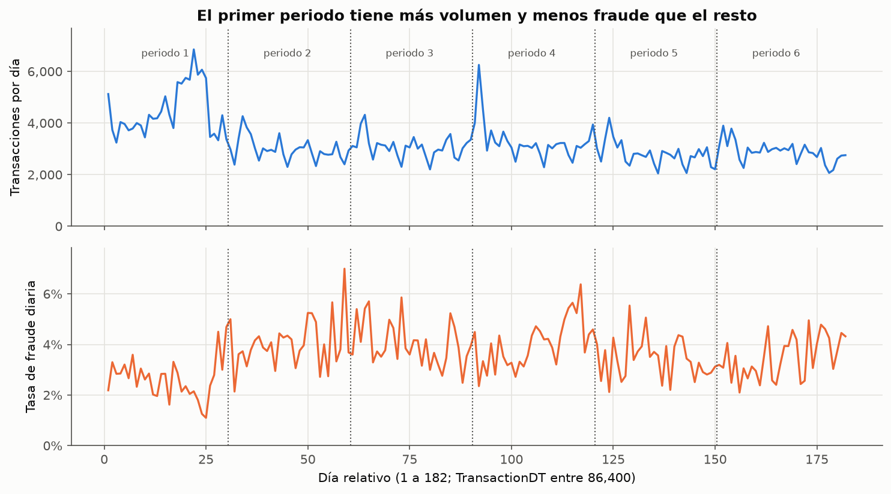{#fig-serie}

La @fig-serie muestra que el primer periodo tiene 50 % más volumen y menos fraude que los demás. Los días 18 a 25 son los de mayor volumen (hasta 6,852) e incluyen las tasas más bajas (1.25 % y 1.10 % en los días 24 y 25). La [sección de cruces](#cruces)
explica de dónde viene esta diferencia.

## Estadística descriptiva

### Importe: localización y variabilidad

| Medida | Todas | Fraude | Legítimas |
| :--- | --: | --: | --: |
| Transacciones | 590,540 | 20,663 | 569,877 |
| Media | 135.03 | 149.25 | 134.51 |
| Mediana | 68.77 | 75.00 | 68.50 |
| Media recortada (10 %) | 89.80 | 100.89 | 89.46 |
| Moda (frecuencia) | 59 (30,582) | 117 (719) | 59 (29,936) |
| Percentiles 25 / 75 | 43.32 / 125.00 | 35.04 / 161.00 | 43.97 / 120.00 |
| Percentiles 90 / 99 | 275.29 / 1,104 | 335.00 / 994 | 267.11 / 1,104 |
| Mínimo / máximo | 0.25 / 31,937 | 0.29 / 5,191 | 0.25 / 31,937 |
| Desviación estándar | 239.16 | 232.21 | 239.40 |
| Rango intercuartil (IQR) | 81.68 | 125.96 | 76.03 |
| Desviación absoluta mediana (MAD) | 38.80 | 46.14 | 38.50 |
| Coeficiente de variación | 1.77 | 1.56 | 1.78 |
| Asimetría | 14.37 | 5.46 | 14.67 |
| Exceso de curtosis | 1,124 | 53 | 1,159 |
| **Media ÷ mediana** | **1.96** | **1.99** | **1.96** |
| **Desviación estándar ÷ IQR** | **2.93** | **1.84** | **3.15** |


- **Sesgo:** la media es casi el doble de la mediana y la asimetría es 14.4. La distribución
  tiene una cola larga a la derecha.
- **Atípicos:** la desviación estándar es casi tres veces el IQR (en una normal sería 0.74
  veces) y el exceso de curtosis es 1,124. Hay valores extremos legítimos: el máximo (31,937)
  está 29 veces por encima del percentil 99. Por eso el importe se describe con **mediana, IQR
  y MAD**, y los gráficos usan escala logarítmica.
- **Fraude frente a legítimas:** las medianas son parecidas, pero el centro del fraude es más
  disperso (IQR 126 frente a 76; percentil 90 de 335 frente a 267). Los valores extremos están
  entre las legítimas.

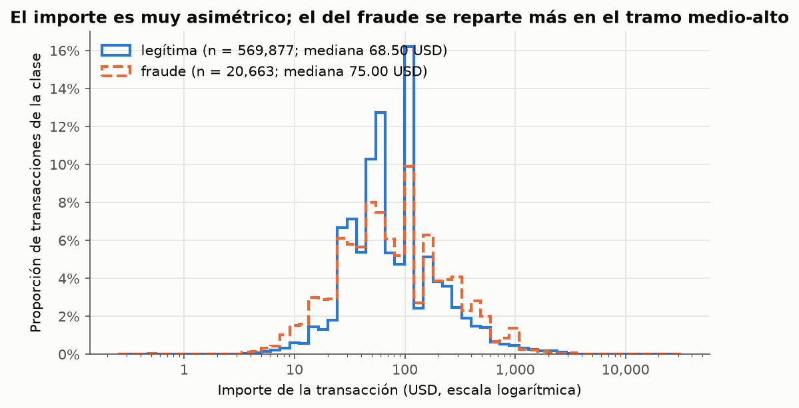{#fig-importe}

La @fig-importe usa intervalos logarítmicos porque el importe abarca cuatro órdenes de
magnitud, y compara proporciones porque las clases tienen tamaños muy distintos.

### Importe por grupo

| Producto | Transacciones | Mediana | IQR | Tasa de fraude |
| :--- | --: | --: | --: | --: |
| C | 68,519 | 31.19 | 35.68 | **11.69 %** |
| S | 11,628 | 35.00 | 60.00 | 5.90 % |
| H | 33,024 | 50.00 | 65.00 | 4.77 % |
| W | 439,670 | 78.50 | 97.00 | 2.04 % |
| R | 37,699 | 125.00 | 100.00 | 3.78 % |

: Importe y tasa de fraude por producto, ordenados por mediana {#tbl-producto tbl-colwidths="[16,21,21,21,21]"}

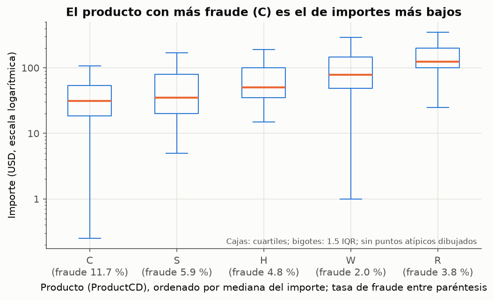{#fig-producto}

La @fig-producto y la @tbl-producto muestran que **el producto con más fraude (C) es el de
importes más bajos**. Por tipo de tarjeta, el crédito tiene mayor mediana (100 frente a 59) y
mayor tasa (6.68 % frente a 2.43 %). Las transacciones con identidad tienen menor mediana (50
frente a 77.95). Entre periodos la mediana va de 59.95 a 75 y el máximo extremo está en el
periodo 3.

### Otras variables numéricas

| Variable | Mediana fraude / legítimas | Lo relevante |
| :--- | :--- | :--- |
| `hora` | 16 / 16 | Moda 23 en fraude y 19 en legítimas; la distribución es casi igual |
| `D1` (diferencia de tiempo; Vesta no publica su definición) | 0 / 4 | Vale 0 en el 57 % de los fraudes y en el 47 % de las legítimas |
| `C1` (conteo; definición no publicada) | 2 / 1 | Percentil 90: 30 frente a 6; percentil 99: 510 frente a 159 |

: Otras numéricas por clase {#tbl-otras tbl-colwidths="[30,22,48]"}

### Heterogeneidad de las categóricas

| Variable | Categorías | Moda (proporción) | Entropía normalizada | Tasa de fraude, mínima y máxima |
| :--- | --: | :--- | --: | :--- |
| `ProductCD` | 5 | W (74.5 %) | 0.549 | 2.04 % (W) a 11.69 % (C) |
| `card4` | 5 | visa (65.2 %) | 0.479 | 2.87 % (american express) a 7.73 % (discover) |
| `card6` | 5 | debit (74.5 %) | 0.362 | 2.43 % (debit) a 6.68 % (credit) |
| `DeviceType` | 3 | sin dato (76.2 %) | 0.646 | 2.10 % (sin dato) a 10.17 % (mobile) |
| `P_emaildomain` | 60 | gmail.com (38.7 %) | 0.489 | 0.40 % (sbcglobal.net) a 9.46 % (outlook.com)\* |
| `tiene_identidad` | 2 | sin identidad (75.6 %) | 0.802 | 2.09 % (sin) a 7.85 % (con) |

: Variables categóricas; el dato ausente cuenta como una categoría más {#tbl-categoricas tbl-colwidths="[16,11,19,13,41]"}

\* Entre los dominios con al menos 1,000 transacciones. Con menos, las tasas son inestables
(por ejemplo, `protonmail.com`: 31 fraudes en 76).

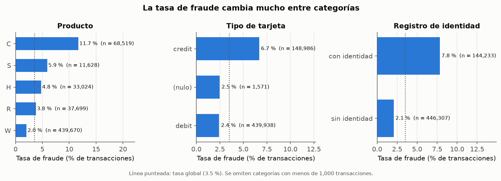{#fig-tasas}

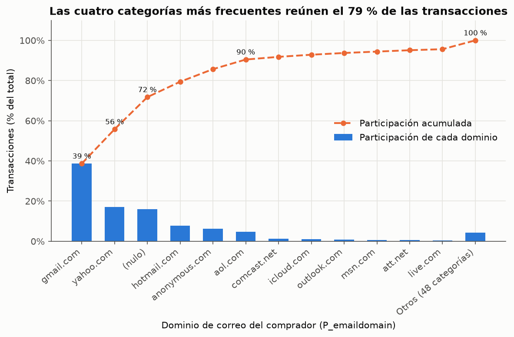{#fig-pareto}

La @fig-tasas confirma que la tasa cambia mucho entre categorías: la de C es casi seis veces
la de W. La @fig-pareto muestra la concentración del correo: cuatro categorías (gmail, yahoo,
el dato ausente y hotmail) reúnen el 79 % de las transacciones, y seis llegan al 90 %.

## Concentración: Gini y curva de Lorenz

El coeficiente de Gini se calcula con la fórmula del PDF; el código usa una equivalente sobre los
valores ordenados y comprueba en cada corrida que las dos den lo mismo.

::: {.callout-note appearance="minimal" title="Unidad y ceros, declarados"}
**G1:** importe; la unidad es la transacción, sin ceros (mínimo 0.25 USD).
**G2:** fraudes y monto defraudado por valor de `card1`, un atributo enmascarado de la tarjeta
(no una tarjeta individual); se incluyen los 11,813 valores sin fraude,
porque excluirlos ocultaría la concentración. Se usan conteos y montos, no tasas: con pocas
transacciones por valor, la tasa es inestable.
:::

| Variable | Grupo | Gini | El 1 % superior reúne | El 10 % superior reúne |
| :--- | :--- | --: | --: | --: |
| G1 · importe | Todas | 0.553 | 13.9 % | 45.4 % |
| | Fraude | **0.586** | 10.7 % | **45.1 %** |
| | Legítimas | 0.551 | 14.0 % | 45.4 % |
| | Por periodo | 0.528 a 0.569 | | 42.4 a 47.0 % |
| | Por producto | 0.357 (R) a 0.553 (W) | | 29.1 a 45.9 % |
| G2 · por valor de `card1` | Transacciones | 0.888 | 53.0 % | 85.0 % |
| | Fraudes | **0.973** | 67.2 % | **98.1 %** |
| | Monto defraudado | 0.974 | 66.0 % | 99.2 % |
| | Fraudes, por periodo | 0.968 a 0.979 | | |

: Coeficiente de Gini y participación del top-k {#tbl-gini tbl-colwidths="[24,22,16,19,19]"}

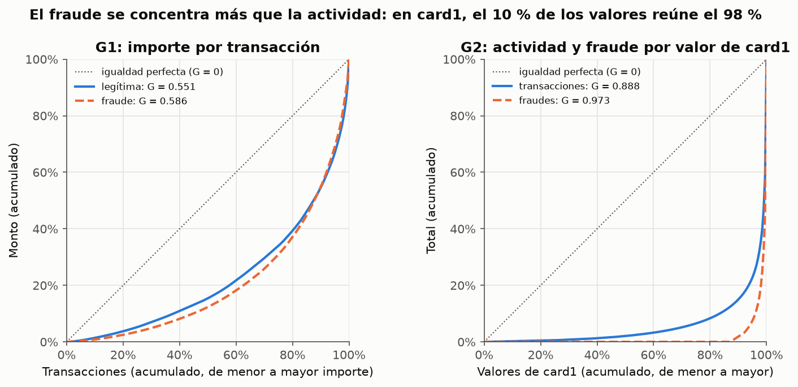{#fig-lorenz}

- **G1 (P2):** el 10 % de los fraudes de mayor importe reúne el 45 % del dinero defraudado.
  Un orden que pondere por importe tiene mucho que ganar frente a uno que solo cuente fraudes.
  La concentración es estable entre periodos.
- **G2 (P1):** el fraude está más concentrado que la actividad (la curva naranja de la
  @fig-lorenz queda por debajo de la azul): el 87 % de los valores de `card1` no tiene ningún
  fraude. `card1` lleva señal, pero es una variable de muy alta cardinalidad con el fraude en
  pocos valores, el terreno de la fuga de información conocida en este dataset (riesgo 3).

## Heterogeneidad: entropía

$H_{norm} = -\sum_k p_k \log_2 p_k \,/\, \log_2 K$. Cada comparación usa el mismo conjunto de
categorías, porque la entropía crece con K. En la versión agrupada del correo, los dominios
con menos del 1 % de las transacciones pasan a «Otros» (quedan 9 categorías).

| Variable | K | Fraude | Legítimas | Lectura |
| :--- | --: | --: | --: | :--- |
| `ProductCD` | 5 | **0.760** | 0.535 | El fraude se reparte entre productos; las legítimas se concentran en W |
| `card6` | 5 | 0.438 | 0.357 | El crédito pesa más entre los fraudes |
| `P_emaildomain` | 60 | 0.437 | 0.490 | El fraude se concentra en menos dominios (aparece en 43 de 60) |
| `P_emaildomain`, agrupada | 9 | 0.740 | 0.808 | Misma dirección |

: Entropía normalizada por clase {#tbl-entropia tbl-colwidths="[20,6,10,12,52]"}

Por periodo, el correo es estable (0.48 a 0.51), pero la entropía de `ProductCD` cae de
**0.773** en el periodo 1 a 0.43 a 0.49 en los demás (@fig-entropia).

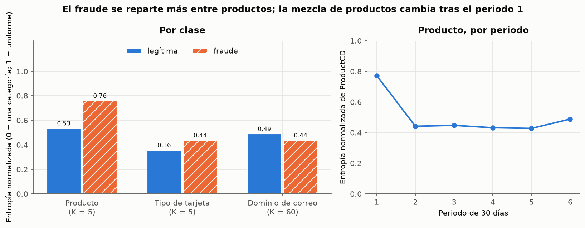{#fig-entropia}

## Calidad de los datos

El paso `calidad` del pipeline diagnostica, sin corregir, las 438 columnas. El tratamiento se
decide en la preparación.

| Problema | Diagnóstico |
| :--- | :--- |
| Faltantes | Solo 24 de las 438 columnas están completas; 214 tienen más de la mitad vacía. Llegan en **bloques** de columnas con exactamente el mismo número de vacíos (por ejemplo, `V12` a `V34`: 76,073 cada una) |
| Faltantes estructurales | `dist1`, `D11`, `M1` a `M3`, `M5` a `M9` y `V1` a `V11` faltan en el 100 % de las transacciones con identidad |
| Duplicados | Ninguno por llave; 3 filas idénticas a otra salvo el identificador; 479 idénticas salvo identificador y tiempo |
| Rangos | `D4`, `D6`, `D11`, `D12`, `D14` y `D15` tienen negativos (mínimo −193) aunque son diferencias de tiempo |
| Llaves sin pareja | 7 de los 59 dominios del comprador no están en la lista D; suman 38,280 filas (7.7 %), casi todas `anonymous.com` |
| Banxico | Total = crédito + débito en número en los 45 trimestres; en monto, 10 trimestres difieren a lo más 1 millón de pesos, por redondeo |

: Diagnóstico de calidad {#tbl-calidad tbl-colwidths="[22,78]"}

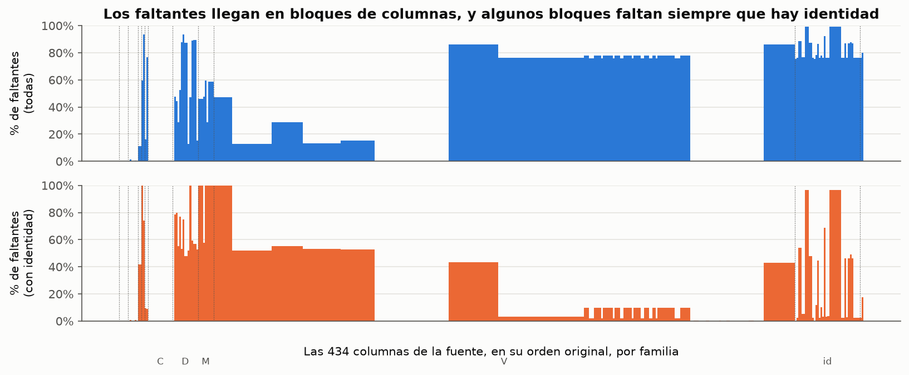{#fig-faltantes}

## Cruces: producto, periodo e identidad {#cruces}

Los dos patrones que más cambian la lectura del EDA aparecen al cruzar el producto con el
periodo y con la identidad (@fig-mezcla).

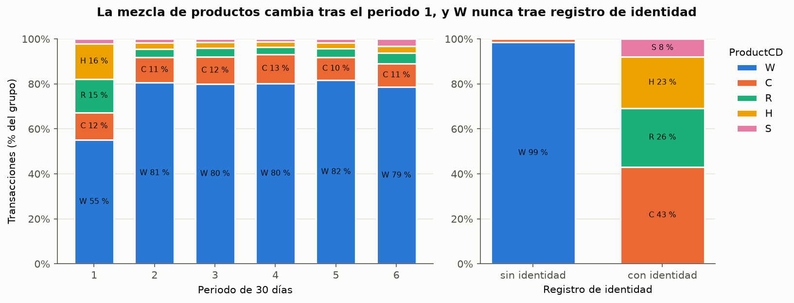{#fig-mezcla}

::: {.panel-tabset}
## Producto por periodo

| Producto | Periodo 1: participación (tasa de fraude) | Periodos 2 a 6: participación (tasa de fraude) |
| :--- | :--- | :--- |
| W | 55 % (1.89 %) | 79 a 82 % (1.84 a 2.20 %), **estable** |
| H | 16 % (1.84 %); 20,903 transacciones | 2 a 3 % (5.9 a 14.4 %); unas 2,300 por periodo |
| R | 15 % (0.98 %); 20,106 transacciones | 3 a 5 % (4.5 a 9.9 %); unas 3,300 por periodo |
| C | 12 % (8.23 %) | 10 a 13 % (12.2 a 13.5 %) |

: Producto por periodo {#tbl-cruce-periodo tbl-colwidths="[14,40,46]"}

## Identidad por producto

| Producto | Sin identidad: transacciones (tasa) | Con identidad: transacciones (tasa) |
| :--- | :--- | :--- |
| W | 439,670 (2.04 %) | **ninguna** |
| C | 6,327 (**5.82 %**) | 62,192 (**12.28 %**) |
| H, R, S | 116, 151 y 43 (muy pocas) | 32,908, 37,548 y 11,585 |

: Identidad por producto {#tbl-cruce-identidad tbl-colwidths="[14,43,43]"}
:::

- **El periodo 1 es otro régimen.** W mantiene su tasa en los seis periodos, pero H y R tienen
  en el primero unas 20 mil transacciones cada uno con muy poco fraude, y después caen a unas
  2 a 3 mil con tasas de 5 a 14 %. Esto explica el menor fraude y la mayor entropía del primer
  periodo.
- **La ausencia de identidad es estructural.** W nunca trae registro de identidad y es el
  98.5 % de las transacciones sin él. La comparación global (2.09 % sin identidad frente a
  7.85 % con ella) mezcla producto e identidad. Dentro de C, el único producto con suficientes
  casos de ambos tipos, la ausencia de identidad **sigue yendo con menos fraude**.

## Brecha con México {#mexico}

Compromiso de E1: medir cuánto se parece IEEE-CIS a la referencia de México (supuesto 1 y
riesgo 1 de E0). Se compara con Banxico (CF621) en **los mismos trimestres** (oct 2017 a
jun 2018) y solo en medidas sin unidades.

| Medida, periodo de IEEE | IEEE-CIS | Banxico | Lectura |
| :--- | --: | --: | :--- |
| Fraude o contracargos, por número | 3.50 % | 0.39 % | IEEE tiene **9.0 veces** más |
| Fraude o contracargos, por monto | 3.87 % | 0.85 % | **4.5 veces** más |
| Crédito ÷ débito, tasa por número | 2.75 | 3.03 | Parecidas |
| Crédito ÷ débito, tasa por monto | 2.11 | 1.87 | Parecidas |
| Crédito ÷ débito, ticket promedio | 1.63 | 2.79 | Distintas |
| Proporción de débito | 74.7 % | 58.2 % | Distintas |

: IEEE-CIS frente a Banxico en el mismo periodo {#tbl-mexico tbl-colwidths="[38,14,14,34]"}

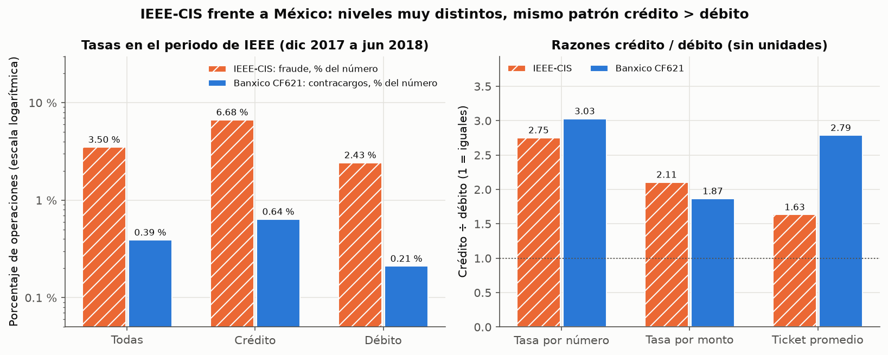{#fig-mexico}

::: {.callout-warning appearance="minimal" title="Las definiciones no son iguales"}
IEEE-CIS marca como fraude el contracargo y las transacciones posteriores ligadas a la misma
cuenta; Banxico cuenta todos los contracargos, sean o no por fraude, sobre las operaciones
autorizadas. El ticket en niveles no se compara (dólares de otra población frente a pesos).
:::

Los niveles no coinciden, así que no se puede
prometer en México la precisión medida en IEEE-CIS; el patrón relativo de riesgo por tipo de
tarjeta sí se parece (@fig-mexico). Dos datos más: en 2026 la razón crédito ÷ débito de Banxico
bajó a 1.19, así que el patrón de 2017-2018 no está garantizado hoy; y la compra promedio de
Banxico en ene-mar 2026 es de **730 pesos**, 16 % por debajo del ticket de 850 que supone el
caso.

## Líneas base del tramo revisado

Compromiso de E0 y E1: fijar los umbrales de las medidas técnicas con la línea base del
dataset. El tramo es el **0.75 % de las transacciones de cada día** (300 de 40,000 en el caso),
con la misma definición que la vista `p2_tramo_diario` de E1. No hay modelo: se comparan las dos
líneas base del ajuste de P1.

| Medida (4,517 transacciones en el tramo) | Regla «mayor importe primero» | Orden aleatorio (esperado) |
| :--- | --: | --: |
| Aciertos en el tramo (fraude ÷ tramo) | **2.97 %** | **3.50 %** |
| Fraude cubierto | 0.65 % | 0.77 % |
| **Monto cubierto** (monto defraudado en el tramo ÷ del día) | **7.58 %** | 0.77 % |
| Aciertos con prevalencia de 1 % (escenario) | 0.84 % | 1.00 % |

: Líneas base del tramo diario {#tbl-tramo tbl-colwidths="[50,25,25]"}

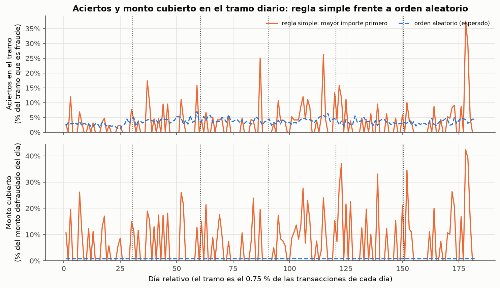{#fig-tramo}

Ordenar por importe da **menos aciertos que el azar** (0.85 veces) pero cubre **casi diez
veces más dinero**, porque los pocos fraudes que atrapa son grandes. Es inestable: la mediana
diaria de aciertos es 0, y por periodo va de 0.56 a 1.18 veces el azar (@fig-tramo).

Con estas líneas base se fijan los umbrales que E0 dejó pendientes (decisión del equipo). El
monto cubierto casi no depende de la prevalencia, así que se fija como porcentaje; los aciertos
sí dependen, así que se fijan en veces sobre el azar, una razón que se conserva al cambiar la
prevalencia.

| Medida de E0 | Piso (debe superarse) | Meta de trabajo |
| :--- | :--- | :--- |
| Monto cubierto por el tramo | 7.58 % (la regla simple) | **20 %**, ligada a la reducción del 20 % de E0 |
| Aciertos en el tramo | Más de 1 vez el azar y más que la regla (0.85) | **2 veces el azar** (provisional) |

: Umbrales de las medidas técnicas, evaluados en la partición de prueba {#tbl-umbrales tbl-colwidths="[28,36,36]"}

::: {.callout-note appearance="minimal"}
El 20 % de monto cubierto es una condición **necesaria, no suficiente**, para reducir la
pérdida un 20 %: los $8.2 millones del caso son la pérdida que queda después de la revisión
actual, y no se sabe cuánto fraude atrapa hoy la cola por orden de llegada.
:::

## Hallazgos

| # | Hallazgo | Tipo | Pregunta |
| :-- | :--- | :--- | :--- |
| H1 | El 10 % de los fraudes de mayor importe concentra el 45 % del monto defraudado | Esperado | P2 |
| H2 | La ausencia de identidad es estructural y va con menos fraude, también dentro de un mismo producto | **Inesperado** | P3 |
| H3 | El primer periodo es otro régimen: H y R con mucho volumen y poco fraude | **Inesperado** | Método |
| H4 | Ordenar por importe no supera al azar en aciertos, aunque cubre diez veces más monto | **Negativo** | P1, P2 |
| H5 | La prevalencia de IEEE-CIS es 9 veces la de México; el patrón crédito ÷ débito se parece | Esperado | Validez externa |
| H6 | El fraude por valor de `card1` está más concentrado que la actividad | Esperado | P1 |

: Resumen de hallazgos {#tbl-hallazgos tbl-colwidths="[6,62,14,18]"}

::: {.panel-tabset}
## H1

**El 10 % de los fraudes de mayor importe concentra el 45.1 % del monto defraudado (Gini
0.586).**

- **Evidencia:** @tbl-gini, @fig-lorenz.
- **Vínculo con E0:** refuerza P2. Ponderar por importe puede cubrir mucho más dinero que
  contar fraudes; la concentración es estable entre periodos.
- **Consecuencia:** conservar el importe sin acotar sus valores extremos (son el fenómeno que
  P2 quiere capturar) y evaluar siempre el monto cubierto junto con los aciertos.

## H2

**Sin identidad, la tasa es 2.09 %; con identidad, 7.85 %. Dentro de C: 5.82 % frente a
12.28 %.**

- **Evidencia:** @tbl-cruce-identidad, @fig-mezcla, @fig-tasas. Verificado en Kaggle con
  código independiente.
- **Vínculo con E0:** responde P3 en sentido contrario a lo que suponía E0. La ausencia de
  identidad no es un hueco al azar: W nunca trae identidad, y dentro de C la ausencia va con
  menos fraude.
- **Consecuencia:** no imputar los campos de identidad como si faltaran al azar. Conservar la
  ausencia como categoría propia (el miembro 0 de `dim_dispositivo`) y analizar identidad
  junto con producto.

## H3

**En el periodo 1, H y R suman unas 41 mil transacciones con tasas de 1.8 % y 1.0 %; después
caen a unas 2,300 (H) y 3,300 (R) por periodo, con tasas de 4.5 a 14.4 %.**

- **Evidencia:** @tbl-cruce-periodo, @fig-serie, @fig-entropia.
- **Vínculo con E0:** afecta el requisito de partición temporal de E0. Un modelo entrenado
  con el primer mes aprendería un comportamiento de H y R que no se repite.
- **Consecuencia:** partición temporal en bloques (entrenamiento días 1 a 120, validación 121
  a 150, prueba 151 a 182), con el periodo 1 documentado dentro del entrenamiento; vigilar el
  desempeño por producto.

## H4

**Aciertos en el tramo: 2.97 % con la regla y 3.50 % al azar; monto cubierto: 7.58 % frente a
0.77 %.**

- **Evidencia:** @tbl-tramo, @fig-tramo, @fig-producto.
- **Vínculo con E0:** P1 y P2. Una regla simple no basta, y aciertos y monto cubierto pueden
  ir en direcciones opuestas (el producto C tiene la tasa más alta y los importes más bajos).
  Es la razón por la que E0 exige medir los dos sobre el mismo tramo.
- **Consecuencia:** umbrales fijados (@tbl-umbrales). El modelo de E3 debe superar a las dos
  líneas base en las dos medidas.

## H5

**Fraude de IEEE-CIS: 3.50 % por número y 3.87 % por monto; contracargos de Banxico en el
mismo periodo: 0.39 % y 0.85 %.**

- **Evidencia:** @tbl-mexico, @fig-mexico.
- **Vínculo con E0:** cumple el compromiso del supuesto 1 y el riesgo 1. Los niveles no se
  transfieren; el patrón relativo por tipo de tarjeta sí.
- **Consecuencia:** reportar los aciertos también con prevalencia ajustada y expresar las
  metas en medidas que no dependen de la prevalencia (@tbl-umbrales).

## H6

**Gini de 0.973 en fraudes por valor de `card1`, frente a 0.888 en transacciones; el 87 % de
los valores no tiene fraude.**

- **Evidencia:** @tbl-gini, @fig-lorenz.
- **Vínculo con E0:** P1 (señal útil) y riesgo 3 (fuga de información).
- **Consecuencia:** cualquier codificación de `card1` que use la etiqueta se calcula solo con
  la partición de entrenamiento.
:::

## Qué cambia para las preguntas de E0

| Pregunta | Después del EDA |
| :--- | :--- |
| P1 · atributos que separan el fraude | Hay señal en producto, tipo de tarjeta, identidad, correo, `card1`, `D1` y `C1`. La regla simple queda por debajo del azar en aciertos: hace falta un modelo |
| P2 · monto cubierto en el tramo | La concentración del fraude por importe (H1) da margen; aciertos y monto pueden divergir (H4) |
| P3 · ausencia de identidad | Respondida en lo descriptivo: la ausencia es informativa y estructural, y va con menos fraude (H2) |
| P4 · rechazos automáticos | Sin cambio: ninguna fuente registra rechazos (no cubierta) |

: Estado de las preguntas tras el EDA {#tbl-preguntas tbl-colwidths="[30,70]"}
