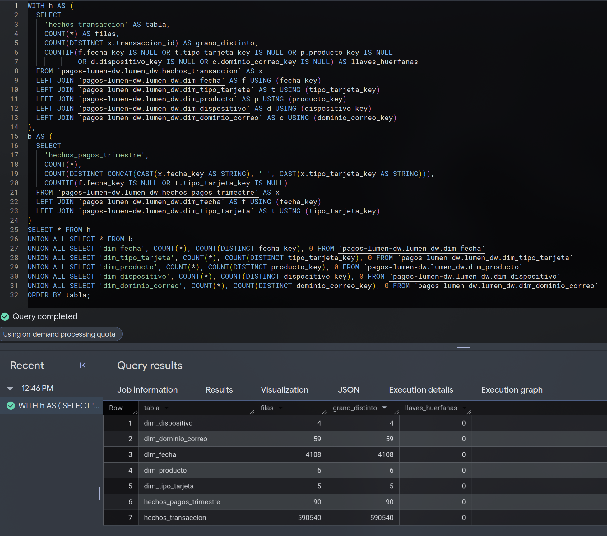
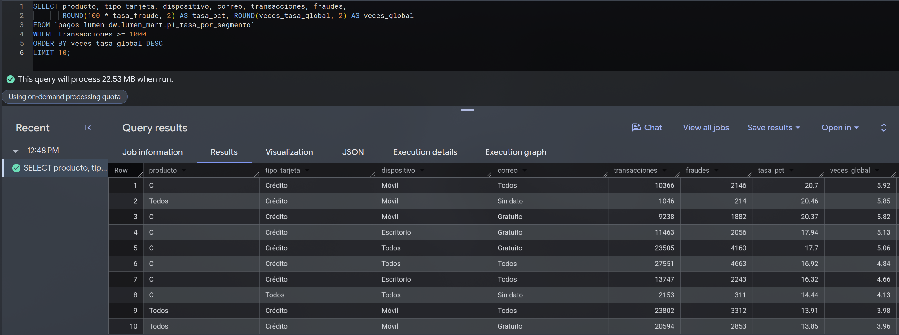
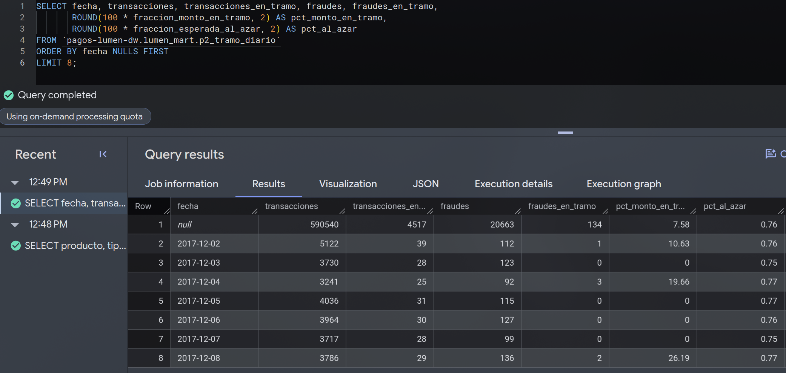
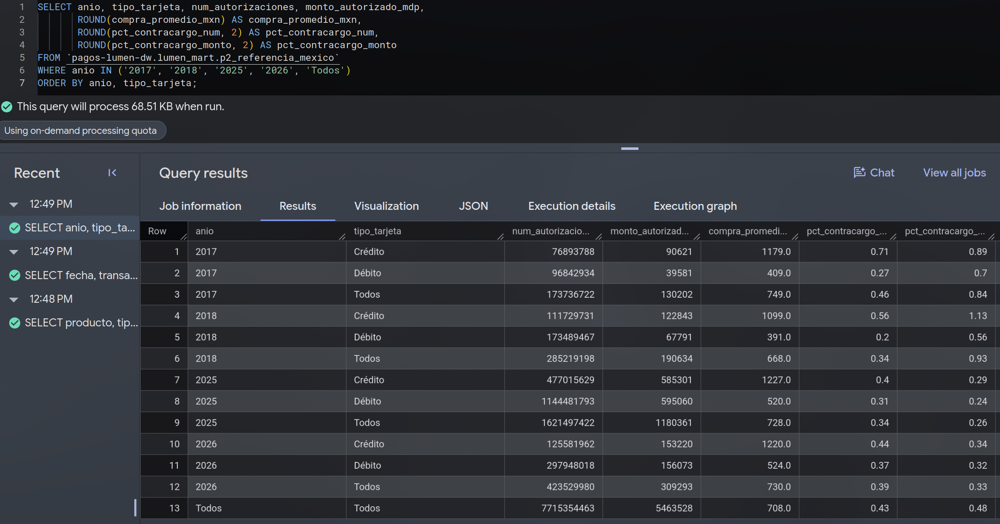
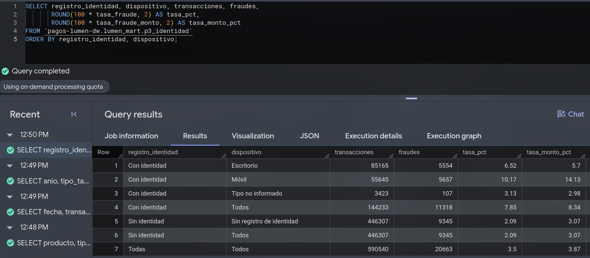

<style>
  /* Tablas con texto largo en la primera columna (anula la regla global) */
  body main table td:first-child { white-space: normal; }
</style>

Esta página describe el [pipeline](https://github.com/alangm-98/Proyecto_Mineria_Datos/tree/main/pipeline)
que lleva los datos de staging al DW de E1 y muestra el resultado: el esquema estrella poblado con
las 590,540 transacciones, la evidencia de que la carga es consistente y las consultas del
DataMart ejecutadas. El diseño del DW es el de [E1](../E1_arquitectura_dw/estrella.qmd) y no
cambió.

::: {.callout-tip appearance="minimal"}
**En una frase:** un solo comando lleva staging al DW en ocho pasos con 35 validaciones de la
carga; correrlo dos veces da el mismo resultado, otra integrante lo reprodujo desde un clon limpio
con resultados idénticos, y las cuatro consultas del DataMart reproducen desde el DW las cifras
del EDA.
:::

## Arquitectura

```{mermaid}
flowchart TB
  S[("lumen_staging · datos crudos, solo lectura")]
  subgraph prep["lumen_prep · preparación"]
    direction LR
    I["ingesta"] --> C["calidad"] --> L["limpieza"] --> R["reduccion"] --> M["muestreo"] --> A["antes_despues"]
  end
  subgraph dw["lumen_dw"]
    K["carga · esquema estrella de E1"]
  end
  subgraph mart["lumen_mart"]
    D["datamart · vistas de E1"]
  end
  S --> prep --> dw --> mart
  style prep fill:#f4f8fd,stroke:#2a78d6
  style dw fill:#f4f8fd,stroke:#2a78d6
  style mart fill:#f4f8fd,stroke:#2a78d6
```

Staging nunca se modifica: el pipeline solo lee de ahí. Cada paso escribe en su capa con
`CREATE OR REPLACE` o vaciando y volviendo a llenar, así que correrlo dos veces da el mismo
resultado.

| Paso | Qué hace | Duración y datos procesados |
| :--- | :--- | :--- |
| Verificación previa | Credenciales, ubicación y filas de staging | ~3 s; solo metadatos |
| `ingesta` | Une y tipa las fuentes sin limpiar: `analitico_crudo`, Banxico y dominios | ~25 s; 1.1 GB |
| `calidad` | Diagnóstico sin corregir (faltantes, duplicados, rangos, categorías) | ~3 min; 2.3 GB |
| `limpieza` | `analitico_limpio` y registro de limpieza ([página 2](preparacion.qmd#limpieza)) | ~1.5 min; 3.6 GB |
| `reduccion` | Tabla de decisión y vista `analitico_reducido` ([página 2](preparacion.qmd#reduccion)) | 2.5 a 13 min según la máquina; 1.1 GB |
| `muestreo` | Mide los criterios del muestreo y registra la decisión | ~5 s; 5 MB |
| `antes_despues` | Comprueba que la preparación conserva el fenómeno ([página 2](preparacion.qmd#antes-despues)) | ~20 s; 1.9 GB |
| `carga` | Pobla el esquema estrella y lo valida | ~65 s; 0.1 GB |
| `datamart` | Ejecuta las vistas de E1 y cruza sus resultados con el DW y el EDA | ~15 s; 0.1 GB |

: Pasos del pipeline; una corrida completa tarda de 10 a 20 minutos según la máquina y procesa unos 10 GB {#tbl-pasos tbl-colwidths="[18,56,26]"}

::: {.callout-note collapse="true" title="Cómo ejecutarlo"}
Desde la carpeta `pipeline/`, con Python fijado por `uv` y credenciales de aplicación por defecto
(instrucciones completas en el README del pipeline):

```bash
uv sync --frozen                                   # entorno con las versiones de uv.lock
uv run python run_pipeline.py --solo-verificar     # credenciales y staging
uv run python run_pipeline.py                      # los ocho pasos
uv run python run_pipeline.py --desde carga        # solo un tramo
```

Para otro proyecto de Google Cloud basta cambiar `proyecto.id` en `config.yaml`: el paso
`carga` crea las tablas y vistas de E1 si no existen.
:::

### Requisitos del PDF

| Requisito | Cómo se cumple |
| :--- | :--- |
| Un solo punto de entrada, pasos separados y nombrados | `run_pipeline.py`, con los pasos `ingesta`, `calidad`, `limpieza`, `reduccion`, `muestreo` y `carga`, más `antes_despues` y `datamart` |
| Sin pasos manuales; idempotente | Todo es SQL o Python ejecutado por el pipeline. Demostrado con dos corridas (@tbl-idempotencia) |
| Semilla, versiones y parámetros | Semilla en `config.yaml`; Python 3.13.18 y librerías fijadas en `uv.lock` y `requirements.txt`; umbrales, datasets y tablas en `config.yaml`; rutas relativas |
| Registro por paso | Archivo en `logs/` con filas de entrada y salida, bytes procesados y duración; registro de limpieza en `lumen_prep` |
| Validaciones automáticas | Llaves no nulas, grano único, rangos y totales en cada paso; si una falla, el pipeline se detiene |
| Credenciales y datos | Credenciales de aplicación por defecto, fuera del repositorio; los datos de IEEE-CIS viven solo en BigQuery |
| Prueba externa | Hecha por una integrante que no escribió el pipeline, desde un clon limpio y con su cuenta: resultados idénticos ([abajo](#prueba-externa)) |

: Requisitos del pipeline reproducible {#tbl-requisitos tbl-colwidths="[30,70]"}

## Carga del esquema estrella

El paso `carga` ejecuta cuatro archivos SQL en orden:

1. **`06_ddl_dw.sql`** crea las tablas de E1 solo si no existen, con el mismo DDL. En el proyecto
   del equipo ya existían desde E1, así que no se modificaron. El paso compara además el esquema
   de cada tabla con el DDL y falla si no coincide.
2. **`07_carga_dimensiones.sql`** vacía y llena las dimensiones de tipo 1 con los catálogos de E1.
3. **`08_scd2_dominio.sql`** actualiza `dim_dominio_correo` conservando su historia (abajo).
4. **`09_carga_hechos.sql`** vacía y llena los dos hechos desde `analitico_limpio` y
   `banxico_trimestres`.

Las llaves de los hechos se buscan en las dimensiones, con el dato ausente emparejado con el
miembro 0. Si un valor de la fuente no tuviera miembro en su dimensión, la llave quedaría vacía y
BigQuery rechazaría la carga: nada se asigna a «Desconocido» en silencio.

| Tabla | Filas | Contenido |
| :--- | ---: | :--- |
| `hechos_transaccion` | 590,540 | Una fila por transacción; 20,663 fraudes; 79,738,948.73 USD |
| `hechos_pagos_trimestre` | 90 | 45 trimestres de Banxico (2015 a 2026) × crédito y débito |
| `dim_fecha` | 4,108 | Del 1 de enero de 2015 al 31 de marzo de 2026; 182 días con `dia_relativo_ieee` |
| `dim_tipo_tarjeta` | 5 | Miembro 0 más débito, crédito, débito o crédito y tarjeta de cargo |
| `dim_producto` | 6 | Miembro 0 más C, H, R, S y W |
| `dim_dispositivo` | 4 | Sin registro de identidad (0), escritorio, móvil y tipo no informado |
| `dim_dominio_correo` | 59 | Miembro 0 más 58 dominios, ya normalizados en la limpieza |

: Tablas del DW después de la carga {#tbl-dw tbl-colwidths="[26,12,62]"}

## Evidencia de consistencia

El paso `carga` hace 35 validaciones y las guarda en `lumen_prep.carga_validaciones` y en
[`carga_validaciones.csv`](https://github.com/alangm-98/Proyecto_Mineria_Datos/blob/main/pipeline/salidas/carga_validaciones.csv).
Las 35 pasaron.

| Qué se valida | Resultado |
| :--- | :--- |
| Grano único | 590,540 `transaccion_id` distintos en 590,540 filas; 90 pares trimestre y tarjeta en 90 filas |
| Llaves huérfanas | 0 en las cinco llaves de `hechos_transaccion` y en las dos de `hechos_pagos_trimestre` |
| Totales contra la tabla limpia | Mismas filas, mismos 20,663 fraudes, mismo monto y mismo monto defraudado (3,083,844.86 USD) |
| Totales contra Banxico | 7,715,354,463 autorizaciones y 5,463,528 mdp, iguales a `banxico_trimestres` |
| Transacciones por miembro, contra E1 | Tipo de tarjeta 1,571 / 439,938 / 148,986 / 30 / 15 y dispositivo 446,307 / 85,165 / 55,645 / 3,423: **idénticos** a los que publicó `estrella.qmd` |
| Dimensiones | Llaves únicas, miembro 0 presente, `dim_fecha` sin huecos, una versión vigente por dominio |
| Rangos | Porcentajes de Banxico entre 0 y 100; `monto_fraude_usd` = `monto_usd` × `es_fraude` en todas las filas |

: Validaciones de la carga (resumen de las 35) {#tbl-validaciones tbl-colwidths="[28,72]"}

La consulta de @fig-consistencia, escrita aparte del pipeline, confirma en la consola de BigQuery el
grano único y la ausencia de llaves huérfanas en las siete tablas.

{#fig-consistencia}

{#fig-hechos width="70%"}

### Prueba externa {#prueba-externa}

**Melanie Valeria Rangel Salcedo**, que no escribió el pipeline, lo ejecutó el 8 de noviembre de
2026 en su laptop, desde un clon limpio del commit `78533eb`, con su propia cuenta de Google y
siguiendo solo el README del pipeline.

| Qué se comprobó | Resultado |
| :--- | :--- |
| Entorno | Arch Linux; `uv` 0.13.7; Python 3.13.18 instalado por `uv`; Google Cloud SDK 592.0.0 |
| Pipeline completo, ocho pasos | Terminó en 1,193 s con las mismas cifras en todos los pasos: 25 tratamientos de limpieza, 271 columnas conservadas, 53 componentes, 35 validaciones de la carga y los mismos resultados del DataMart |
| Prueba de SCD 2 | Mismas versiones, llaves y fechas que en @tbl-scd2 |
| `git status` al terminar | Ningún cambio en código, configuración ni páginas. Solo dos CSV con diferencias en el decimal 15 (redondeo de punto flotante) y cuatro PNG con otra compresión; comparados píxel por píxel, las figuras son iguales |

: Resultado de la prueba externa {#tbl-prueba-externa tbl-colwidths="[26,74]"}

La prueba encontró dos huecos del README, que ya están corregidos:

1. **Versión de `uv`.** Con `uv` 0.12.15, `uv sync --frozen` falló porque esa versión no conoce
   Python 3.13.18. El README pide ahora `uv` 0.13.6 o posterior, y `pyproject.toml` lo exige con un
   mensaje claro.
2. **Un permiso faltante.** Los pasos que descargan resultados usan la API de lectura de BigQuery,
   que pide el rol BigQuery Read Session User. El README lo agrega a su tabla de permisos.

El tiempo fue cerca del doble que en la máquina donde se desarrolló el pipeline: las consultas en BigQuery
tardaron lo mismo, pero el cálculo local de `reduccion` (χ² y Spearman) tomó 13 minutos en lugar
de 2.5.

### Idempotencia

| Medida | Primera corrida | Segunda corrida |
| :--- | :--- | :--- |
| Versiones nuevas en `dim_dominio_correo` | 59 | **0** (siguen 59) |
| Filas de las siete tablas | 4,108 / 5 / 6 / 4 / 59 / 590,540 / 90 | Iguales |
| Validaciones de la carga | 35 correctas | 35 correctas |
| Resultados del DataMart | 374 / 183 / 37 / 7 filas | Iguales |

: Dos corridas seguidas de `carga` y `datamart` {#tbl-idempotencia tbl-colwidths="[34,36,30]"}

### Historia de los dominios (SCD tipo 2)

E1 definió `dim_dominio_correo` con historia porque la lista de correo gratuito cambia con
frecuencia: cada cambio debe crear una versión nueva sin borrar la anterior. La carga no vacía esta
dimensión. Cierra la versión vigente de un dominio cuya clasificación cambió y le crea otra.

Para probarlo sin tocar el DW, `pruebas/prueba_scd2.py` crea un dataset temporal con el esquema de
E1, aplica la lista real dos veces y después una lista simulada del 8 de noviembre de 2026 en la
que `gmail.com` deja de ser gratuito y `anonymous.com` pasa a serlo. Al terminar borra el dataset.

| Llave | Dominio | Gratuito | Válido desde | Válido hasta | Vigente |
| ---: | :--- | :--- | :--- | :--- | :--- |
| 2 | `anonymous.com` | No | 2026-10-09 | 2026-11-07 | No |
| 59 | `anonymous.com` | Sí | 2026-11-08 | 9999-12-31 | Sí |
| 16 | `gmail.com` | Sí | 2026-10-09 | 2026-11-07 | No |
| 60 | `gmail.com` | No | 2026-11-08 | 9999-12-31 | Sí |

: Versiones de los dominios cambiados en la prueba ([`prueba_scd2.csv`](https://github.com/alangm-98/Proyecto_Mineria_Datos/blob/main/pipeline/salidas/prueba_scd2.csv)) {#tbl-scd2 tbl-colwidths="[10,26,14,18,18,14]"}

Cada corrida repetida con la misma lista no creó versiones, y la lista simulada creó exactamente
dos, una por dominio cambiado. La versión anterior queda cerrada el día previo y conserva su llave,
así que un resultado calculado con la lista vieja se puede reproducir.

## DataMart

Las cuatro vistas de E1 se ejecutaron sobre el DW poblado. El paso `datamart` guarda sus resultados
completos en `pipeline/salidas/mart_*.csv` y comprueba que reproducen las cifras del EDA.

::: {.panel-tabset}
## P1 · Segmentos

**`p1_tasa_por_segmento` (GROUP BY CUBE).** Calcula la tasa de fraude de las 374 combinaciones
de producto, tipo de tarjeta, dispositivo y correo gratuito, con sus subtotales.

{#fig-mart-p1}

**Lectura.** El segmento con más fraude es el producto C con tarjeta de crédito en móvil: 20.70 %,
**5.92 veces** la tasa global, en 10,366 transacciones. Los diez primeros tienen el producto C, la
tarjeta de crédito o ambos. En el otro extremo, W con débito y correo no gratuito tiene 1.03 % (0.29 veces). El correo
gratuito separa menos: 3.71 % frente a 2.29 % del no gratuito. El filtro de 1,000 transacciones
importa: 188 de las 374 combinaciones son más chicas, y sus tasas son inestables (16 transacciones
con 6 fraudes dan 37.5 %). Esta vista es la línea base descriptiva de P1; un modelo la
reemplazará.

## P2 · Tramo diario

**`p2_tramo_diario` (funciones de ventana y ROLLUP).** Ordena cada día por la regla simple (mayor
importe primero), marca el 0.75 % superior y mide cuánto fraude contiene. La fila sin fecha es el
total.

{#fig-mart-p2-tramo}

**Lectura.** En el periodo, el tramo tiene 4,517 transacciones (0.76 %), contiene 134 fraudes y
**7.58 % del monto defraudado**, frente a 0.76 % que cubriría un orden al azar: unas 10 veces más
dinero, pero no más aciertos (2.97 % de fraude en el tramo contra 3.50 % global). Además es muy
irregular: en 103 de los 182 días el tramo no contiene ningún fraude. Son las mismas cifras que las
[líneas base del EDA](eda.qmd#líneas-base-del-tramo-revisado), calculadas ahora desde el DW. La
referencia al azar difiere por redondeo: el EDA la da como 0.77 % porque pondera cada día por su
monto defraudado, y la vista usa la fracción global del tramo (4,517 ÷ 590,540). Cuando exista el
modelo, solo cambia el orden de la ventana.

## P2 · México

**`p2_referencia_mexico` (ROLLUP).** Autorizaciones, compra promedio y contracargos del comercio
electrónico en México por año y tipo de tarjeta. Los porcentajes se ponderan por número o por
monto, no se promedian.

{#fig-mart-p2-mexico}

**Lectura.** En 2017 y 2018, los años de IEEE-CIS, los contracargos fueron 0.46 % y 0.34 % por
número, y 0.84 % y 0.93 % por monto. En el primer trimestre de 2026, 0.39 % y 0.33 %, con una compra
promedio de 730 pesos (1,220 con crédito, 524 con débito). Es la referencia contra la que el
[EDA](eda.qmd#mexico) midió la brecha: el fraude de IEEE-CIS (3.50 %) es 9 veces
los contracargos de México por número en los mismos trimestres, y las definiciones no son
iguales.

## P3 · Identidad

**`p3_identidad` (ROLLUP).** Tasa de fraude por número y por monto, con y sin registro de
identidad, y por tipo de dispositivo.

{#fig-mart-p3}

**Lectura.** Con registro de identidad la tasa es **7.85 %** y sin él **2.09 %** (3.75 veces);
por monto, 8.34 % frente a 3.07 %. Dentro de las que tienen identidad, el móvil es el más riesgoso:
10.17 % por número y 14.13 % por monto. Ojo con la causa: el producto W nunca trae identidad, así
que parte de la diferencia es del producto ([cruces del EDA](eda.qmd#cruces)).
:::

Las cuatro consultas responden con los datos cargados. P4 sigue sin consulta, como se declaró en E1:
ninguna fuente trae las operaciones rechazadas ni su desenlace.
