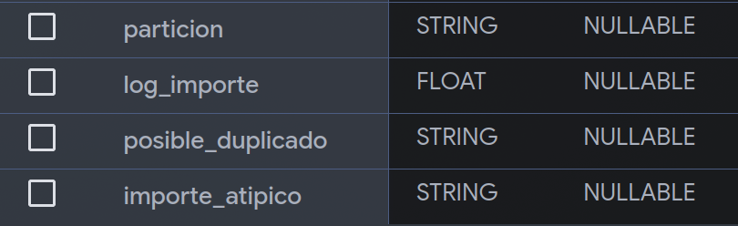
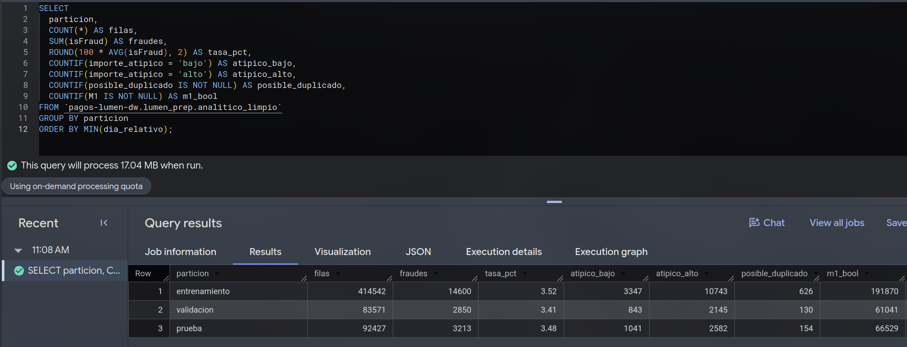
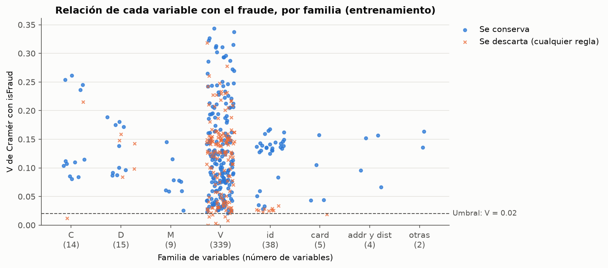
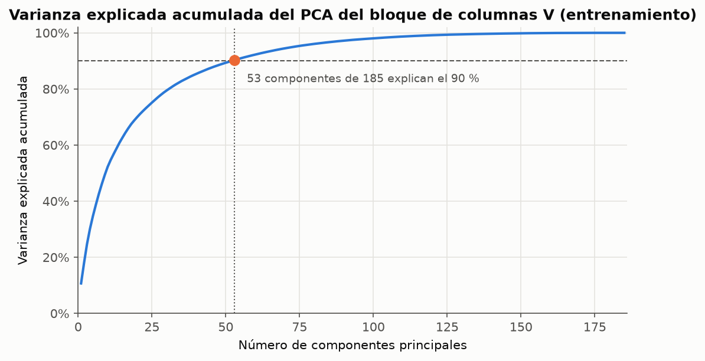
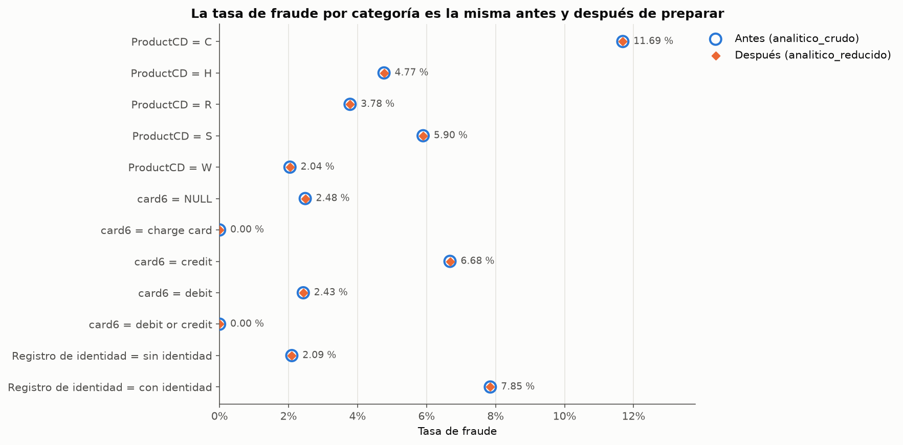
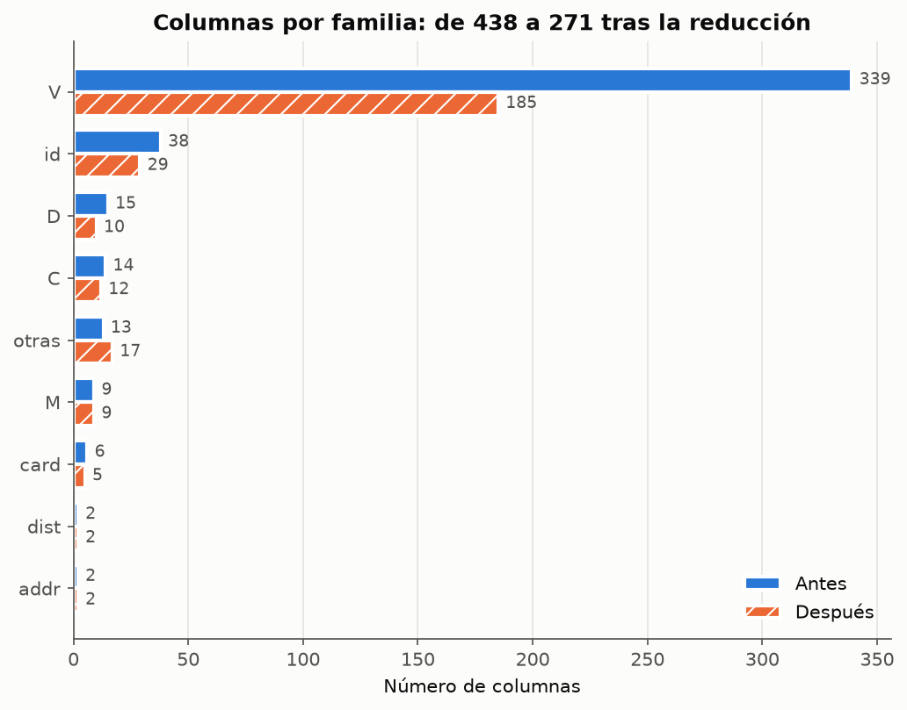

<style>
  /* Tablas con texto largo en la primera columna (anula la regla global) */
  body main table td:first-child { white-space: normal; }
</style>

Esta página documenta cómo el [dataset analítico del EDA](eda.qmd) se convierte en el dataset
listo para modelar: qué se corrigió, qué variables se conservan y por qué, y la comprobación de
que el fenómeno de fraude sigue intacto. Responde a la Parte B del PDF de E2. Todo lo hace el
[pipeline](https://github.com/alangm-98/Proyecto_Mineria_Datos/tree/main/pipeline) con las
**590,540 transacciones completas**.

::: {.callout-tip appearance="minimal"}
**En una frase:** no se eliminó ni se imputó ninguna fila, la reducción pasó de 438 a 271
columnas con reglas declaradas y ajustadas solo con la partición de entrenamiento, no hizo falta
muestrear, y las 28 medidas que sostienen los hallazgos del EDA quedaron idénticas.
:::

## Del dato crudo al dataset reducido

| Etapa | Objeto en BigQuery | Filas | Columnas | Qué cambia |
| :--- | :--- | ---: | ---: | :--- |
| Antes de preparar | `lumen_prep.analitico_crudo` | 590,540 | 438 | Transacciones e identidad unidas, sin limpiar |
| Limpieza | `lumen_prep.analitico_limpio` | 590,540 | 442 | Correo normalizado, T/F a lógico y cuatro columnas nuevas |
| Reducción | `lumen_prep.analitico_reducido` (vista) | 590,540 | 271 | Solo las columnas que se conservan |

: Etapas de la preparación {#tbl-etapas tbl-colwidths="[16,30,11,11,32]"}

El DW no cambia con la reducción: su esquema estrella ([E1](../E1_arquitectura_dw/estrella.qmd))
solo usa campos de negocio, y todos están protegidos (ver [reducción](#reduccion)).

::: {.callout-note collapse="true" title="Cómo reproducir esta página"}
Desde la carpeta `pipeline/` del repositorio, con las credenciales configuradas (ver su README):

```bash
uv run python run_pipeline.py --desde limpieza --hasta antes_despues
```

Los pasos `limpieza`, `reduccion` y `antes_despues` escriben sus tablas en `lumen_prep`, sus
copias CSV en `pipeline/salidas/` y las figuras de esta página. La tabla de decisión completa del
final de esta página también la genera el pipeline. Duración medida: unos 4 minutos y 6.6 GB
procesados en BigQuery.
:::

## Partición temporal y fuga de información {#particion}

La tarea de E3 es supervisada (predecir `isFraud`), así que todo lo que **aprende parámetros de
los datos** se ajusta solo con la partición de entrenamiento. Si los límites de un atípico o la
mediana para imputar se calcularan con los 182 días, los días de prueba influirían en el
entrenamiento y la evaluación de E3 sería optimista.

La partición es por **bloques de días contiguos**, no aleatoria: el modelo de E3 se entrena con
el pasado y se evalúa con el futuro, como operaría en Lumen. Coincide con los periodos del EDA.

| Partición | Días | Transacciones | Fraudes | Tasa de fraude |
| :--- | :--- | ---: | ---: | ---: |
| Entrenamiento | 1 a 120 | 414,542 | 14,600 | 3.52 % |
| Validación | 121 a 150 | 83,571 | 2,850 | 3.41 % |
| Prueba | 151 a 182 | 92,427 | 3,213 | 3.48 % |

: Partición temporal; la tasa de fraude es estable entre bloques {#tbl-particion tbl-colwidths="[22,16,22,18,22]"}

| Qué se aprende de los datos | Dónde | Con qué datos |
| :--- | :--- | :--- |
| Límites de importe atípico (cuartiles de ln del importe) | `limpieza` | Entrenamiento |
| Cuantiles para discretizar, χ², V de Cramér, valor dominante y faltantes | `reduccion` | Entrenamiento |
| Correlación de Spearman | `reduccion` | Entrenamiento |
| Mediana para imputar, media y desviación para estandarizar, y PCA | `reduccion` | Entrenamiento |

: Parámetros aprendidos y partición con la que se ajustan {#tbl-fuga tbl-colwidths="[56,18,26]"}

La partición definitiva la decide el modelado. La que se usa aquí vive en `config.yaml` y queda
como columna `particion` de la tabla limpia.

## Limpieza {#limpieza}

Primero se diagnosticó (paso `calidad`, [resumen en el EDA](eda.qmd#calidad-de-los-datos)) y
después se decidió. **Nada se elimina ni se imputa en silencio:** el pipeline escribe un registro
con cada tratamiento y lo valida (mismas filas y llaves, mismos faltantes columna por columna).

| Problema | Variable | Afectadas | Fraudes | Decisión |
| :--- | :--- | ---: | ---: | :--- |
| Faltantes estructurales | 40 columnas de identidad | 17,852,280 celdas | | Conservar NULL |
| Otros faltantes | Resto de columnas | 97,670,793 celdas | | Conservar NULL; sin imputar |
| Duplicados por llave | `TransactionID` | 0 | | Ninguna acción |
| Posibles duplicados | Todo salvo el ID | 6 filas | 0 | Conservar y marcar |
| Posibles duplicados | Todo salvo el ID y el tiempo | 904 filas | 6 | Conservar y marcar |
| Importe atípico bajo | `TransactionAmt` < 8.65 USD | 5,231 filas | 404 | Conservar y marcar |
| Importe atípico alto | `TransactionAmt` > 620.63 USD | 15,470 filas | 740 | Conservar y marcar |
| Valores negativos | `D4`, `D6`, `D11`, `D12`, `D14`, `D15` | 45 celdas | 0 | Conservar |
| Categorías inconsistentes | `P_emaildomain` / `R_emaildomain` (`gmail` → `gmail.com`) | 496 / 95 filas | 11 / 0 | Normalizar |
| Dominio anonimizado | `anonymous.com` en P / R | 36,998 / 20,529 filas | 859 / 598 | Conservar como dominio propio |
| Llaves que no coinciden | Dominios de P / R fuera de la lista D | 37,784 / 20,879 filas | 865 / 600 | Conservar; no es correo gratuito |
| Tipos | `M1` a `M9` (salvo `M4`) e `id_35` a `id_38` | 2,916,349 celdas | | Texto T/F a lógico |
| Llaves que no coinciden | Identidad sin transacción | 0 | | Ninguna acción |

: Registro de limpieza (resumen de `registro_limpieza`) {#tbl-limpieza tbl-colwidths="[19,30,17,10,24]"}

::: {.panel-tabset}
## Faltantes

**No se imputa ni se borra.** En las columnas de identidad la ausencia es estructural: las
446,307 transacciones sin registro de identidad no pueden tener esos valores, y esa ausencia es
información (7.85 % de fraude con identidad, 2.09 % sin ella; H3 del EDA). Llenarlas con una
mediana las haría parecer transacciones con identidad. Además, una mediana calculada con todos
los días sería fuga. Si un método de E3 necesita imputar, se ajusta con entrenamiento (como ya se
hace para el PCA).

## Atípicos

**Se marcan y no se acotan.** La regla del IQR aplicada al importe en dólares daría un límite
de 125 + 1.5 × 81.68 = 247.5 USD y marcaría más del 10 % de las transacciones (el percentil 90 es
275.29 USD): no son atípicos, es la cola de una distribución con asimetría 14.4. Por eso la regla
se aplica a ln(importe), con cuartiles de entrenamiento, y marca 3.5 % de las filas.

- **Los altos son parte del fenómeno:** 4.78 % de fraude (contra 3.50 % general) y **25.6 % del
  monto defraudado**. Acotarlos cambiaría la medida que suma P2.
- **Los bajos fueron inesperados:** 7.72 % de fraude, más del doble del promedio. Es compatible
  con cargos pequeños para probar una tarjeta, pero esa lectura es una hipótesis para E3.

## Duplicados y negativos

**Posibles duplicados.** No hay dos filas con el mismo `TransactionID`. Hay 6 filas idénticas a
otra salvo el identificador y 904 idénticas salvo el identificador y el tiempo. Se conservan
porque el grano es la transacción y un cobro repetido puede ser legítimo o un intento de fraude;
quedan marcadas en `posible_duplicado` (6 fraudes entre las 904, 0.66 %).

**Negativos en las columnas D.** Vesta solo describe las D como intervalos de tiempo y no
declara error un negativo; son 45 celdas y ninguna es fraude. Sin una fuente que lo justifique no
se corrigen (supuesto: referencias de tiempo distintas).

## Categorías y tipos

**Correo.** Los dominios pasan a minúsculas y sin espacios, y una tabla de equivalencias en
`config.yaml` une `gmail` con `gmail.com`. No había mayúsculas ni espacios: solo cambiaron las
filas de `gmail`. `anonymous.com` parece una etiqueta de anonimización de Vesta; se conserva como
dominio propio. Los demás dominios fuera de la lista de correo gratuito son proveedores de
internet o institucionales.

**Tipos.** Las columnas con valores `T`/`F` pasan a lógicas; `M4` sigue como texto porque trae
`M0`, `M1` y `M2`.
:::

La tabla limpia agrega cuatro columnas: `particion`, `log_importe`, `posible_duplicado` e
`importe_atipico` (@fig-limpio-esquema). La consulta de @fig-limpio-resumen comprueba la
partición y las marcas contra el registro.

{#fig-limpio-esquema width="55%"}

{#fig-limpio-resumen}

## Reducción de dimensionalidad {#reduccion}

Las tres técnicas se aplican con la partición de entrenamiento completa y cada variable recibe
una decisión. Primero se protegen 16 columnas que nunca se descartan: llaves, variable objetivo,
los campos que usa el DW (`TransactionDT`, `TransactionAmt`, `ProductCD`, `card6`,
`P_emaildomain`, `DeviceType`, `tiene_identidad` y el tiempo derivado) y las columnas de la
limpieza. Las demás pasan por cuatro filtros, en orden:

| Filtro | Regla | Descartadas |
| :--- | :--- | ---: |
| Faltantes | Falta en más del 95 % de las filas donde aplica (identidad: filas con identidad) | 9 |
| Casi constante | Un mismo valor, contando el NULL, ocupa al menos el 99.9 % de las filas | 4 |
| Relevancia | χ² contra `isFraud`: p ≥ 0.05 / 440 (Bonferroni) **o** V de Cramér < 0.02 | 7 |
| Redundancia | Spearman \|ρ\| ≥ 0.95: de cada par se conserva la de mayor V | 151 |

: Reglas de reducción y resultado {#tbl-reglas tbl-colwidths="[16,66,18]"}

| Familia | Columnas | Faltantes | Casi constante | Relevancia | Redundancia | Se conservan |
| :--- | ---: | ---: | ---: | ---: | ---: | ---: |
| V (enmascaradas de Vesta) | 339 | | 4 | 5 | 145 | 185 |
| id (identidad) | 38 | 9 | | | | 29 |
| D (intervalos de tiempo) | 15 | | | | 5 | 10 |
| C (conteos) | 14 | | | 1 | 1 | 12 |
| M (coincidencias) | 9 | | | | | 9 |
| card, addr, dist | 10 | | | 1 | | 9 |
| Otras (incluye 15 de las 16 protegidas) | 17 | | | | | 17 |
| **Total** | **442** | **9** | **4** | **7** | **151** | **271** |

: Decisiones por familia {#tbl-familias tbl-colwidths="[28,12,12,12,12,12,12]"}

::: {.panel-tabset}
## χ² y V de Cramér

Las numéricas se discretizan en deciles de entrenamiento (un valor muy frecuente, como el cero,
va en su propio grupo) y el NULL es un grupo más. Las categorías de menos del 1 % se juntan en
«Otros», y cualquier grupo con frecuencia esperada menor que 5 en una celda también; la menor
frecuencia esperada final es 5.04.

**Con 414,542 filas casi todo es significativo, así que decide el tamaño del efecto.** Por azar,
una variable sin relación con el fraude da V ≈ √(9 / 414,542) ≈ 0.005, muy debajo de 0.02. El
ejemplo es `card4` (marca de la tarjeta): p = 4.7 × 10⁻³⁰, muy significativa, pero V = 0.019,
y se descarta. Solo `V41` falla además por p (0.089).

{#fig-vcramer}

@fig-vcramer muestra que la señal se reparte en todas las familias y que las V llegan más alto
(`V258`, V = 0.344) que cualquier campo de negocio (`ProductCD`, 0.161).

## Correlación

La correlación de Spearman (monótona, adecuada para importes sesgados y conteos) se calcula en
las filas donde las dos columnas existen, entre las 387 numéricas que llegan a este filtro. Hay
507 pares con \|ρ\| ≥ 0.95. Se recorren las columnas de mayor a menor V y se descarta una si es
redundante con otra ya conservada.

El método se validó solo: encontró que **`D9` es la hora del día** (ρ = 1.000 con `hora`, que
derivamos de `TransactionDT`), y pares casi idénticos como `D4` con `D12` (1.000), `D5` con `D7`
(0.999), `D2` con `D1` (0.981) y `C10` con `C8` (0.971). Correlación no implica causalidad: aquí
solo indica información repetida.

## PCA

Se aplica solo al bloque V conservado (185 columnas numéricas cuyo significado Vesta no publica).
Las lógicas y categóricas no entran. Antes se imputa la mediana y se estandariza, con parámetros
de entrenamiento.

{#fig-pca}

Hacen falta **53 componentes para el 90 %** de la varianza (31 para el 80 %), y la primera
explica solo 10.7 %: tras quitar las redundancias, el bloque tiene muchas dimensiones medianas, no
unas pocas dominantes. **Decisión: ambas.** La vista conserva las columnas originales, que son
interpretables y miden su relación con el fraude una por una; los pesos, medianas y
desviaciones de las 53 componentes quedan en `pipeline/salidas/reduccion_pca_cargas.csv` para que
E3 compare las dos representaciones.
:::

::: {.callout-note appearance="minimal" title="Una hipótesis que los datos rechazaron"}
Como `V258` falta en el 75.6 % de las filas, supusimos que su V alto venía de *si falta o no*,
igual que la identidad. La tasa sí cambia (7.22 % con valor, 2.33 % sin él;
@fig-v258), pero ese indicador solo da V = 0.114: explica (0.114 / 0.344)² ≈ **11 %** de la
relación. El otro 89 % está en los valores. La señal del bloque V no se reduce a su patrón de
faltantes.

{#fig-v258 width="75%"}
:::

## Muestreo

**No se muestrea.** El PDF lo justifica solo por volumen, por desbalance o por redundancia entre
registros, y ninguna razón aplica a la preparación:

- **Volumen.** La limpieza procesa unos 3.6 GB por corrida y la reducción 1.1 GB, frente a
  1 TB gratuito al mes de BigQuery; la partición de entrenamiento ocupa unos 1.5 GB en memoria y
  la reducción tarda 2 minutos.
- **Desbalance.** El fraude es el 3.50 %. Balancear clases es una técnica del modelado: si E3 la
  usa, será solo dentro de la partición de entrenamiento y después de separar validación y
  prueba; hacerlo antes filtraría información.
- **Redundancia.** Solo 910 filas (0.15 %) tienen un posible duplicado.

Por eso el dataset y el DW conservan las 590,540 transacciones y ninguna cifra de E2 sale de una
muestra. El paso `muestreo` del pipeline mide estos criterios en cada corrida (1.13 GB, 3.50 % de
fraude, 0.15 % de posibles duplicados) y registra la decisión en `lumen_prep.muestreo_decision`.

## Verificación: antes y después {#antes-despues}

El paso `antes_despues` calcula las mismas medidas sobre `analitico_crudo` y sobre la vista
reducida. Cada medida declara si se espera que cambie, y el paso falla si cambia una que no
debía.

| Variable | Medida | Antes | Después |
| :--- | :--- | ---: | ---: |
| `isFraud` | Transacciones / fraudes | 590,540 / 20,663 | 590,540 / 20,663 |
| `isFraud` | Tasa de fraude | 3.50 % | 3.50 % |
| `TransactionAmt` | Media / mediana (USD) | 135.03 / 68.77 | 135.03 / 68.77 |
| `TransactionAmt` | Monto defraudado (USD) | 3,083,844.86 | 3,083,844.86 |
| `TransactionAmt` | Gini: todas / fraudes (H1) | 0.553 / 0.586 | 0.553 / 0.586 |
| `ProductCD` | Tasa de fraude C / W (H2) | 11.69 % / 2.04 % | 11.69 % / 2.04 % |
| `card6` | Tasa de fraude crédito / débito | 6.68 % / 2.43 % | 6.68 % / 2.43 % |
| `tiene_identidad` | Tasa con / sin identidad (H3) | 7.85 % / 2.09 % | 7.85 % / 2.09 % |
| `P_emaildomain` | Dominios distintos / entropía (bits) | 59 / 2.681 | 58 / 2.671 |
| `P_emaildomain` | Transacciones con `gmail.com` | 228,355 | 228,851 |
| Dataset | Columnas / celdas nulas | 438 / 115.5 M (44.7 %) | 271 / 70.5 M (44.0 %) |

: Medidas clave antes y después (selección de las 43 de `antes_despues`) {#tbl-antes-despues tbl-colwidths="[17,35,24,24]"}

{#fig-tasas-ad}

{#fig-columnas-ad}

**Conclusión: la preparación conservó el fenómeno que E0 quiere estudiar.** Las 28 medidas que
debían quedar igual son idénticas, incluidas las tasas por partición y por categoría
(@fig-tasas-ad) y la concentración del monto. Solo cambiaron, a propósito, el correo (496
transacciones de `gmail` pasan a `gmail.com`, un dominio menos) y la dimensión: de 438 a 271
columnas, sobre todo en el bloque V, de 339 a 185 (@fig-columnas-ad). Ningún hallazgo del EDA
desaparece.

## Tabla de decisión por variable

Cada una de las 442 columnas de la tabla limpia, con las técnicas aplicadas, la decisión y su
evidencia. La versión con todas las medidas (faltantes, valor dominante, V, p, grupos, frecuencia
esperada mínima y \|ρ\| máxima) está en
[`reduccion_decision.csv`](https://github.com/alangm-98/Proyecto_Mineria_Datos/blob/main/pipeline/salidas/reduccion_decision.csv).

::: {.callout-note collapse="true" title="Ver la tabla completa (442 variables)"}

:::
