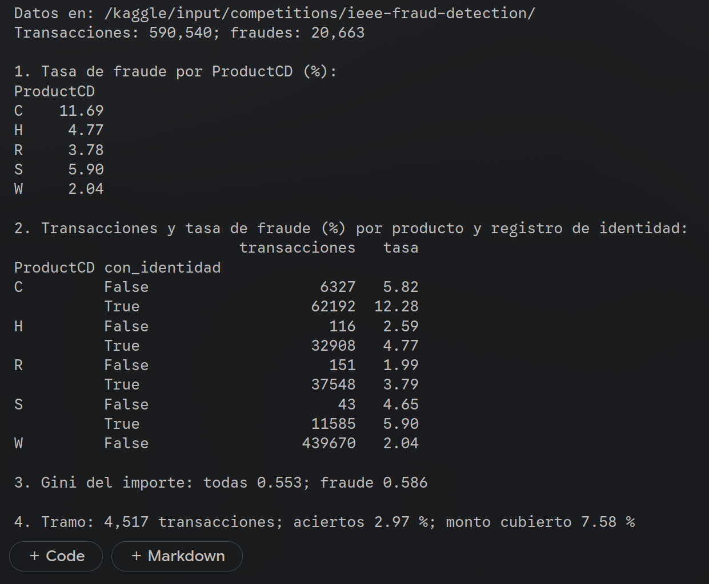

<style>
  /* Tablas con texto largo en la primera columna (anula la regla global) */
  body main table td:first-child { white-space: normal; }
</style>

::: {.callout-important appearance="minimal" title="Declaración general"}
El equipo **sí utilizó herramientas de IA** en esta entrega. Un modelo de lenguaje escribió el
código del pipeline y del análisis exploratorio, propuso los métodos de preparación y sus
alternativas, sugirió interpretaciones de los resultados y propuso redacciones de las páginas.
El equipo tomó todas las decisiones, ejecutó todo el código en BigQuery, en sus máquinas y en
Kaggle, comprobó las cifras y revisó cada salida antes de publicarla. El modelo no tuvo acceso al
proyecto de BigQuery ni a los datos de transacciones.
:::

## Resumen de usos

Esta página registra solo los usos que cambiaron el resultado de la entrega. Las consultas sobre
el manejo de las herramientas y las tareas mecánicas no se detallan.

| # | Herramienta y modelo | Tarea | Detalle |
| :-- | :--- | :--- | :--- |
| 1 | Claude (Anthropic), modelo Opus 5.5 | Plan de la entrega y revisión continua contra el PDF | [Uso 1](#uso-1) |
| 2 | Claude (Anthropic), modelo Opus 5.5 | Código del análisis exploratorio e interpretación de resultados | [Uso 2](#uso-2) |
| 3 | Claude (Anthropic), modelo Opus 5.5 | Métodos de limpieza, reducción y verificación antes y después | [Uso 3](#uso-3) |
| 4 | Claude (Anthropic), modelo Opus 5.5 | Pipeline reproducible, carga del DW y DataMart | [Uso 4](#uso-4) |
| 5 | Claude (Anthropic), modelo Opus 5.5 | Redacción de las páginas y revisión del sitio | [Uso 5](#uso-5) |

: {tbl-colwidths="[4,34,46,16]"}

Todos los usos ocurrieron en una sola conversación, del 7 al 15 de noviembre de 2026. No se empleó
ninguna otra herramienta de IA. Como en E0 y E1, los prompts se registran como resumen fiel; las
instrucciones del equipo que marcaron el trabajo se citan textualmente.

---

## Uso 1 · Plan de la entrega y revisión contra el PDF {#uso-1}

**Tarea.** Leer las indicaciones de E2 junto con lo hecho en E0 y E1, proponer un plan por fases y
revisar cada fase contra los requisitos del PDF antes de cerrarla.

**Prompts empleados (resumen fiel).** El equipo entregó al modelo su documento interno de contexto,
los PDF de E0 a E2 y el enlace del repositorio. Pidió primero leer y revisar, sin construir nada, y
después un plan por fases. En cada fase pidió una propuesta con las decisiones abiertas, sus
alternativas y una recomendación, y no avanzó hasta aprobarla.

**Qué se hizo con la salida.** El equipo aprobó el plan y tomó las decisiones de fondo: cargar la
fuente A completa en BigQuery, crear un dataset intermedio (`lumen_prep`) sin tocar staging ni el
DW de E1, orquestar archivos SQL desde Python y usar Kaggle solo para verificar. La revisión contra
el PDF detectó dos omisiones del propio modelo, que se corrigieron antes de publicar (ver
[errores](#errores)).

---

## Uso 2 · Análisis exploratorio {#uso-2}

**Tarea.** Escribir el módulo de análisis (`pipeline/eda/`): estadística descriptiva, Gini y curva
de Lorenz, entropía, figuras, brecha con México y líneas base del tramo revisado. Proponer
interpretaciones de los resultados y opciones para los umbrales de las medidas técnicas y para la
partición temporal.

**Prompts empleados (resumen fiel).** El equipo pidió cubrir las cuatro dimensiones de la
descriptiva y las medidas de concentración y heterogeneidad del PDF, con cada figura justificada,
y una redacción «concreta y concisa, sin perder detalles cruciales, sin em dashes, aprovechando
Quarto». Para los umbrales y la partición pidió alternativas con sus consecuencias, no una sola
propuesta.

**Cómo se verificó.**

- El equipo ejecutó todo el análisis en su máquina, contra la tabla analítica completa en BigQuery.
- El código comprueba en cada corrida que las dos fórmulas del Gini (la del PDF y la de valores
  ordenados) den lo mismo.
- Cuatro cifras clave se recalcularon en Kaggle con código independiente (ver
  [verificación en Kaggle](#kaggle)).
- Cada interpretación del modelo se contrastó con una cifra antes de entrar a la página (ver
  [interpretaciones](#interpretaciones)).

**Qué se hizo con la salida.** El equipo eligió la partición temporal en bloques de días (1 a 120,
121 a 150 y 151 a 182) y los umbrales: monto cubierto con piso de 7.58 % y meta de 20 %, y aciertos
expresados en veces sobre el azar, con meta provisional de 2 veces.

---

## Uso 3 · Limpieza, reducción y verificación {#uso-3}

**Tarea.** Proponer el tratamiento de cada problema de calidad, el método de reducción de
dimensionalidad y la comprobación de que la preparación no distorsiona el fenómeno; escribir los
pasos `limpieza`, `reduccion` y `antes_despues`.

**Prompts empleados (resumen fiel).** El equipo pidió una propuesta por problema con la técnica, la
justificación y el impacto que exige el PDF, y que todo lo que aprende de los datos se ajustara solo
con la partición de entrenamiento. Al revisar los primeros archivos pidió que los comentarios del
código y la configuración documentaran el código y los datos, no la conversación.

**Cómo se verificó.**

- Antes de entregar cada paso, el modelo lo probó con datos sintéticos: la limpieza en DuckDB, con
  el SQL traducido, y la reducción con 414,542 filas sintéticas, el tamaño real de entrenamiento.
- Cada paso trae validaciones automáticas: mismas filas y llaves, mismos faltantes columna por
  columna y marcas iguales al registro.
- Antes de cada corrida, el modelo anunció los conteos esperados y el equipo los comparó con la
  salida real.
- El paso `antes_despues` recalcula 43 medidas sobre el dato crudo y el preparado, y falla si
  cambia una que no debía. Las 28 que debían quedar igual son idénticas.

**Qué se hizo con la salida.** El equipo aprobó no imputar ni borrar filas, marcar duplicados y
atípicos sin acotarlos, aplicar la regla del IQR a ln(importe), proteger 16 columnas, los cuatro
filtros de reducción y conservar el bloque V original junto con su PCA. También decidió no
muestrear y que el balanceo de clases, si hace falta, se decida en E3.

---

## Uso 4 · Pipeline, carga del DW y DataMart {#uso-4}

**Tarea.** Escribir el pipeline completo (ocho pasos, un solo comando), la carga idempotente del
esquema estrella de E1 con historia de tipo 2 en `dim_dominio_correo`, las validaciones de la
carga, la ejecución de las vistas del DataMart y el guion de la prueba externa.

**Prompts empleados (resumen fiel).** El equipo pidió que la carga no modificara nada de E1, que
pudiera ejecutarse dos veces con el mismo resultado y que fallara en voz alta ante cualquier
inconsistencia. Para la prueba externa pidió un guion que dijera qué registrar sin reemplazar al
README.

**Cómo se verificó.**

- El modelo probó la carga dos veces y el DataMart con datos sintéticos en DuckDB.
- La carga trae 35 validaciones; entre ellas, que los conteos por miembro de cada dimensión
  coincidan con los publicados en E1.
- El equipo corrió el pipeline completo dos veces con resultados idénticos y ejecutó la prueba de
  historia de tipo 2 con una lista de dominios simulada.
- Una integrante que no escribió el pipeline lo ejecutó desde un clon limpio, en su máquina, solo
  con el README, y obtuvo las mismas cifras.
- El modelo revisó cada commit sobre un clon limpio del repositorio: archivos, ausencia de datos
  reales y de credenciales, y que el código fuera idéntico al revisado.

**Qué se hizo con la salida.** La prueba externa encontró dos huecos del README: la versión mínima
de `uv` y un rol de BigQuery que faltaba. El equipo los corrigió en el README y en la
configuración del entorno.

---

## Uso 5 · Redacción de las páginas y revisión del sitio {#uso-5}

**Tarea.** Proponer la redacción de las páginas de E2, el README y la portada, y revisar la
consistencia del sitio.

**Prompts empleados (resumen fiel).** Para la página de decisiones, el equipo pidió «un formato y
presentación que también sea vistoso y bien organizado para el tipo de persona que en teoría se
estaría presentando». Al cierre pidió revisar que las cifras coincidieran entre páginas, que no
hubiera enlaces rotos ni pendientes resueltos, y homogeneizar el estilo.

**Qué se hizo con la salida.** El equipo revisó cada página en la vista previa antes de publicarla
y reescribió por su cuenta la redacción de `eda.qmd` y `decisiones.qmd`. En esa reescritura, la
página de decisiones se ajustó con la lectura de una persona ajena al equipo. El modelo revisó
después esas versiones: señaló una afirmación nueva que ninguna cifra respaldaba y dos
justificaciones que el PDF exige y se habían recortado, y el equipo las corrigió. La revisión de
consistencia encontró tres diferencias menores entre páginas, que se corrigieron.

---

## Interpretaciones propuestas por el modelo y su contraste {#interpretaciones}

Ninguna interpretación entró a las páginas sin una cifra que la respaldara. Las que el modelo
propuso con más peso para la entrega fueron estas:

| Interpretación propuesta | Cómo se contrastó | Resultado |
| :--- | :--- | :--- |
| La diferencia de fraude con y sin identidad (7.85 % contra 2.09 %) podría deberse solo a la mezcla de productos | Cruce de identidad por producto: W nunca trae identidad, y dentro de C la tasa es 12.28 % con identidad y 5.82 % sin ella | **Confirmada:** la ausencia es informativa también dentro de un producto (H2) |
| El primer mes, con más volumen y menos fraude, sería otro régimen por cambio en la mezcla de productos | Cruce de producto por periodo: H y R tienen unas 20 mil transacciones cada uno en el periodo 1 y unas 2 a 3 mil después | **Confirmada** (H3); motivó la partición en bloques de días |
| El V de Cramér alto de `V258` vendría de su patrón de faltantes, como en la identidad | V del indicador «falta o no»: 0.114 contra 0.344 de la variable, es decir, ≈ 11 % de la relación | **Rechazada:** la señal está en los valores; se documenta en la [preparación](preparacion.qmd#reduccion) |
| `D9` sería la hora del día | Correlación de Spearman con la hora derivada de `TransactionDT` | **Confirmada** (ρ = 1.000); se descarta como redundante |
| Los importes muy bajos, con 7.72 % de fraude, serían cargos pequeños para probar tarjetas | Ningún dato del conjunto permite comprobarlo | **Queda como hipótesis para E3**; las páginas no la presentan como hecho |
| El volumen diario alto se mantendría hasta el día 25, como decía el documento de contexto | Serie diaria del EDA: solo los días 18 a 25 superan 5,500 transacciones | **Corregida:** el EDA dice «días 18 a 25» |

: {tbl-colwidths="[34,40,26]"}

---

## Verificación independiente en Kaggle {#kaggle}

Para no depender solo del código que escribió el modelo, cuatro cifras clave se recalcularon en un
notebook de Kaggle, sobre los CSV originales de la competencia, sin BigQuery ni el código del
pipeline y con fórmulas distintas: el Gini como 1 − 2 × área bajo la curva de Lorenz, y el tramo
ordenando con pandas. El modelo escribió el script; el equipo lo ejecutó. Las cuatro coinciden con
el pipeline al último decimal:

| Cifra | Pipeline | Kaggle |
| :--- | --: | --: |
| Tasa de fraude por producto (C / W) | 11.69 % / 2.04 % | 11.69 % / 2.04 % |
| Tasa dentro de C, con / sin identidad | 12.28 % / 5.82 % | 12.28 % / 5.82 % |
| Gini del importe, todas / fraude | 0.553 / 0.586 | 0.553 / 0.586 |
| Tramo: transacciones, aciertos y monto cubierto | 4,517 · 2.97 % · 7.58 % | 4,517 · 2.97 % · 7.58 % |

: {tbl-colwidths="[46,27,27]"}

{#fig-kaggle width="80%"}

::: {.callout-note collapse="true" title="Código del notebook de verificación"}

```python
# Verificación independiente de cifras del EDA de E2 (Pagos Lumen).
# Se ejecuta en un notebook de Kaggle con los datos de la competencia ieee-fraud-detection.
# No usa BigQuery ni el código del pipeline: lee los CSV originales y recalcula con
# fórmulas distintas a las del pipeline.
import numpy as np
import pandas as pd

import glob, os
encontrados = glob.glob("/kaggle/input/**/train_transaction.csv", recursive=True)
assert encontrados, "No se encontró train_transaction.csv en /kaggle/input: revisar el panel Input"
RUTA = os.path.dirname(encontrados[0]) + "/"
print("Datos en:", RUTA)
t = pd.read_csv(RUTA + "train_transaction.csv",
                usecols=["TransactionID", "isFraud", "TransactionDT", "TransactionAmt", "ProductCD"])
ids_identidad = set(pd.read_csv(RUTA + "train_identity.csv", usecols=["TransactionID"])["TransactionID"])
print(f"Transacciones: {len(t):,}; fraudes: {t.isFraud.sum():,}")

# 1. Tasa de fraude por producto (pipeline: C 11.69 %, W 2.04 %)
print("\n1. Tasa de fraude por ProductCD (%):")
print((100 * t.groupby("ProductCD").isFraud.mean()).round(2).to_string())

# 2. Identidad dentro de cada producto (pipeline: W con identidad = 0; C sin 5.82 %, con 12.28 %)
t["con_identidad"] = t.TransactionID.isin(ids_identidad)
print("\n2. Transacciones y tasa de fraude (%) por producto y registro de identidad:")
print(t.groupby(["ProductCD", "con_identidad"]).isFraud.agg(transacciones="size", tasa=lambda s: round(100 * s.mean(), 2)).to_string())

# 3. Gini del importe como 1 - 2 x área bajo la curva de Lorenz (pipeline: 0.553 todas, 0.586 fraude)
def gini_lorenz(x):
    x = np.sort(np.asarray(x, dtype=float))
    acumulado = np.concatenate([[0], np.cumsum(x) / x.sum()])
    area = getattr(np, "trapezoid", None) or np.trapz  # NumPy >= 2.0 o anterior
    return 1 - 2 * area(acumulado, dx=1 / len(x))
print(f"\n3. Gini del importe: todas {gini_lorenz(t.TransactionAmt):.3f}; "
      f"fraude {gini_lorenz(t.TransactionAmt[t.isFraud == 1]):.3f}")

# 4. Tramo del 0.75 % diario ordenado por mayor importe (pipeline: aciertos 2.97 %, monto cubierto 7.58 %)
t["dia"] = t.TransactionDT // 86400
t["k"] = np.ceil(0.0075 * t.groupby("dia").TransactionID.transform("size"))
t = t.sort_values(["dia", "TransactionAmt", "TransactionID"], ascending=[True, False, True])
t["rango"] = t.groupby("dia").cumcount() + 1
tramo = t[t.rango <= t.k]
print(f"\n4. Tramo: {len(tramo):,} transacciones; aciertos {100 * tramo.isFraud.mean():.2f} %; "
      f"monto cubierto {100 * (tramo.TransactionAmt * tramo.isFraud).sum() / (t.TransactionAmt * t.isFraud).sum():.2f} %")
```

:::

---

## Errores con impacto en las salidas del modelo {#errores}

Se registran los errores que, sin detectarse, habrían cambiado el cumplimiento de la entrega, una
cifra publicada o la reproducibilidad. Muestran por qué ninguna salida se usó sin verificar.

| Error | Cómo se detectó | Corrección |
| :--- | :--- | :--- |
| La primera reducción omitía tres requisitos del PDF: frecuencia esperada de al menos 5 por celda en el χ², ajuste del umbral de p por comparaciones múltiples y la columna de técnicas en la tabla de decisión | Al releer el propio modelo el PDF contra la página | Se agregaron y la reducción se volvió a correr; ninguna decisión cambió |
| Recomendó quitar el paso `muestreo`, porque no se muestrea | Al releer el propio modelo el PDF: exige pasos nombrados, entre ellos el muestreo | El paso volvió como evaluación que mide los criterios en cada corrida y registra la decisión |
| Atribuyó la tasa de fraude más baja entre dominios a `att.net` | Al contrastar con la tabla antes de redactar | La página dice `sbcglobal.net` (0.40 %) |
| Los comentarios del código y la configuración citaban acuerdos de la conversación en lugar de describir el código | El equipo, al revisar los archivos antes del commit | Se reescribieron en todos los archivos, incluidos los ya publicados |
| El README del pipeline no incluía el rol BigQuery Read Session User, necesario para leer tablas desde Python | La prueba externa | Se agregó el rol al proyecto y al README |
| Usó un término técnico («dato enmascarado») en la página dirigida a personas que no trabajan con datos | Una persona ajena al equipo no lo entendió al leer la página | El equipo reescribió esa decisión sin el término |

: {tbl-colwidths="[44,26,30]"}
